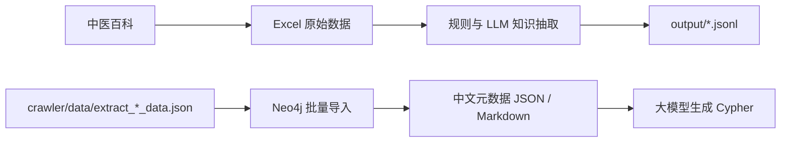

# 中医知识图谱

一个面向中药与方剂知识的中文知识图谱项目，覆盖网页数据采集、实体关系抽取、Neo4j 图谱导入，以及面向大模型的中文元数据导出。

项目当前支持：

- 从中药百科采集中药材和方剂数据，支持限流、断点续爬与 Excel 导出。
- 使用规则与大模型相结合的方式抽取实体、属性和关系。
- 将实体和关系批量导入 Neo4j，支持幂等导入和缺失端点补全。
- 导出带中文语义描述的图数据库元数据，为 Text2Cypher 等大模型任务提供准确结构上下文。

## 数据流程



> 当前 `extract_information` 输出的是 `output/*.jsonl`，`graph_database.import_data` 默认读取的是 `crawler/data/extract_herb_data.json` 和 `crawler/data/extract_formula_data.json`。两种文件结构不同，使用前请确认数据来源。

## 图模型

### 实体标签

| 标签 | 中文含义 | 主要属性 |
| --- | --- | --- |
| `Herb` | 中药材 | `name`、`alias`、`dosage`、`effect`、`indication`、`meridian`、`origin`、`place`、`processing`、`property_flavor`、`taboo`、`traits`、`usage` |
| `Formula` | 方剂 | `name`、`alias`、`effect`、`indication`、`usage`、`taboo`、`ingredients`、`from_source` |
| `Disease` | 疾病、病证或病理状态 | `name` |
| `Symptom` | 症状或体征 | `name` |
| `Effect` | 中医功效 | `name` |
| `Source` | 文献、典籍或其他出处 | `name` |

每个标签的实体名称保存在 `name` 属性中，并以 `(标签, name)` 作为业务唯一标识。同名但类型不同的实体不会被错误合并。

### 关系类型

| 关系类型 | 含义 | 常见方向 |
| --- | --- | --- |
| `TREATS_DISEASE` | 治疗疾病 | `Herb/Formula -> Disease` |
| `ALLEVIATES_SYMPTOM` | 缓解症状 | `Herb/Formula -> Symptom` |
| `HAS_EFFECT` | 具有功效 | `Herb/Formula -> Effect` |
| `HAS_INGREDIENT` | 包含组成 | `Formula -> Herb` |
| `HAS_SYMPTOM` | 疾病包含症状 | `Disease -> Symptom` |
| `FROM_SOURCE` | 来源于文献 | `Herb/Formula -> Source` |

实际数据中还包含少量特殊模式，例如 `Formula -> Formula`、`Herb -> Herb` 和 `Source -> Herb`。完整的实际三元组方向以 [metadata/graph_metadata.md](metadata/graph_metadata.md) 为准。

示例查询：

```cypher
MATCH (h:Herb {name: $name})-[:TREATS_DISEASE]->(d:Disease)
RETURN h.name AS herb, d.name AS disease
LIMIT 25;
```

## 项目结构

```text
.
├── common/                    # 环境配置与 LLM 初始化
├── crawler/                   # 中药、方剂网页采集
│   ├── data/                  # 本地原始数据，默认不提交
│   ├── .cache/                # 断点续爬缓存，默认不提交
│   ├── fangji_spider.py
│   └── zhongyao_spider.py
├── extract_information/       # 规则与 LLM 实体关系抽取
├── graph_database/
│   ├── import_data.py         # Neo4j 批量导入
│   └── export_metadata.py     # 中文图数据库元数据导出
├── metadata/                  # 已导出的图结构元数据
├── tests/                     # pytest 单元测试
├── demo/                      # LangChain 示例
├── pyproject.toml
└── uv.lock
```

## 环境准备

### 依赖

- Python 3.12 或更高版本
- [uv](https://docs.astral.sh/uv/)
- 可访问的 Neo4j 数据库
- OpenAI 兼容大模型接口，用于从主治文本中抽取疾病和症状

安装项目依赖：

```powershell
uv sync
```

### 环境变量

在项目根目录创建本地 `.env` 文件：

```dotenv
# 大模型接口
MODEL_API_KEY=your_model_api_key
MODEL_BASE_URL=https://your-model-endpoint/v1
MODEL_NAME=your_model_name

# Neo4j
NEO4J_URI=bolt://localhost:7687
NEO4J_USER=neo4j
NEO4J_PASSWORD=your_neo4j_password
```

`.env` 已被 `.gitignore` 排除，请勿提交真实密钥。

当前抽取模块在导入时会初始化模型客户端。即使使用 `--no-llm` 跳过实际模型调用，也应先配置 `MODEL_*` 环境变量。

## 使用方式

### 1. 采集中药和方剂

小规模试跑：

```powershell
uv run python crawler/zhongyao_spider.py --limit 5
uv run python crawler/fangji_spider.py --limit 5
```

全量采集：

```powershell
uv run python crawler/zhongyao_spider.py
uv run python crawler/fangji_spider.py
```

默认输出：

```text
crawler/data/中药大全.xlsx
crawler/data/方剂大全.xlsx
```

重复执行时会复用断点续爬缓存；使用 `--refresh` 可忽略缓存重新抓取。脚本会检查站点的 `robots.txt`，并默认在请求之间等待 1～2 秒。

### 2. 抽取知识图谱数据

只执行规则抽取，不调用大模型：

```powershell
uv run python -m extract_information.extract_info --source all --no-llm
```

执行规则和大模型抽取：

```powershell
uv run python -m extract_information.extract_info --source all
```

限制每类处理数量，便于试跑：

```powershell
uv run python -m extract_information.extract_info --source herbs --limit 3
```

抽取结果默认写入 `output/`：

```text
herb_records.jsonl
herb_entities.jsonl
herb_relations.jsonl
formula_records.jsonl
formula_entities.jsonl
formula_relations.jsonl
extract_failed.txt        # 存在失败记录时生成
```

再次执行时会跳过已完成记录；`--refresh` 会清空对应类型的旧结果并重新抽取。

### 3. 导入 Neo4j

导入器默认读取：

```text
crawler/data/extract_herb_data.json
crawler/data/extract_formula_data.json
```

仅检查数据结构和数量，不连接 Neo4j：

```powershell
uv run python -m graph_database.import_data --dry-run
```

正式导入：

```powershell
uv run python -m graph_database.import_data
```

导入过程使用 `MERGE`：

- 重复执行不会重复创建同一实体或关系。
- 关系引用但实体列表未出现的节点会自动补全。
- 默认不删除数据库中的已有节点。
- 可调整批量大小，例如 `--batch-size 1000`。

### 4. 导出图数据库元数据

```powershell
uv run python -m graph_database.export_metadata
```

默认生成：

```text
metadata/graph_metadata.json
metadata/graph_metadata.md
```

元数据内容包括实体标签、属性、属性类型、样例值、关系类型、实际三元组方向以及中文语义说明。`graph_metadata.md` 可直接用于补充大模型提示词，帮助模型使用正确的标签、关系方向、属性和查询方式。

只调整样例数量：

```powershell
uv run python -m graph_database.export_metadata --sample-size 5
```

指定数据库：

```powershell
uv run python -m graph_database.export_metadata --database neo4j
```

导出器只执行只读查询，不会修改数据库，也不会把连接凭据写入元数据文件。

### 5. 知识图谱问答

问答命令只执行只读 Cypher，并返回答案、匹配实体、查询参数和图谱证据：

```powershell
uv run python -m graph_qa.cli --question "麻黄有什么功效？"
```

显示实际执行的 Cypher：

```powershell
uv run python -m graph_qa.cli --question "麻黄有什么功效？" --show-query
```

输出稳定的 JSON，便于程序调用：

```powershell
uv run python -m graph_qa.cli --question "四君子汤由哪些药材组成？" --format json
```

运行黄金问题集：

```powershell
uv run python -m graph_qa.evaluate
```

真实 Neo4j 和模型集成测试默认跳过，确认服务可用后显式启用：

```powershell
$env:GRAPH_QA_RUN_INTEGRATION = "1"
uv run python -m pytest tests/test_graph_qa_integration.py -v
```

问答系统仅提供中医药知识参考，不能替代专业医疗诊断和治疗。Cypher 写操作、多语句、变量长度路径、过程调用和超出 Schema 的查询会被拒绝。

## 测试

运行全部单元测试：

```powershell
uv run python -m pytest tests/ -v
```

测试使用模拟的 Neo4j Driver 和模型结果，不会发起真实数据库或模型请求。运行抽取相关测试时，模块初始化仍会读取 `.env` 中的 `MODEL_*` 配置。

## 数据与安全

- `crawler/data/`、`crawler/.cache/` 和 `output/` 属于本地数据，默认不进入 Git。
- `.env`、虚拟环境、IDE 配置和运行缓存均已忽略。
- 不要向仓库提交 API Key、Neo4j 密码或其他凭据。
- 导入默认采用增量合并；如需重建空图，请在 Neo4j 中显式创建或清理目标数据库。
