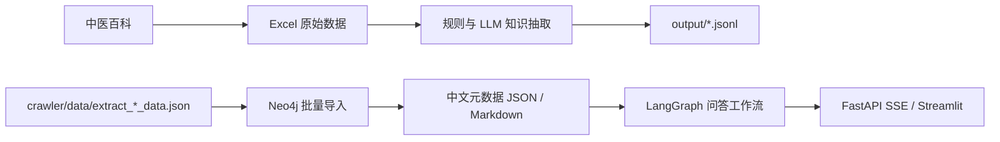

# 中医知识图谱

一个面向中药与方剂知识的中文知识图谱项目，覆盖网页数据采集、实体关系抽取、Neo4j 图谱导入、可验证问答 API、流式输出和 Streamlit 交互界面。

当前系统架构图见
[docs/graph_qa/project-architecture.md](docs/graph_qa/project-architecture.md)。

项目当前支持：

- 从中药百科采集中药材和方剂数据，支持限流、断点续爬与 Excel 导出。
- 使用规则与大模型相结合的方式抽取实体、属性和关系。
- 将实体和关系批量导入 Neo4j，支持幂等导入和缺失端点补全。
- 导出带中文语义描述的图数据库元数据，为 Text2Cypher 等大模型任务提供准确结构上下文。
- 使用 LangGraph 完成意图识别、5 轮语义改写、实体链接、受控检索规划、只读 Cypher 校验、执行和证据回答。
- 使用 `RetrievalAgent` 在属性、统计、多条件、受控关系、白名单两跳和 Schema 约束查询之间规划，并执行 `plan → act → observe → replan` 受控闭环。
- 使用本地 BGE-large + FAISS 补充别名和同义表达召回。
- 提供 CLI、FastAPI SSE 接口和 Streamlit 双栏交互界面。
- 使用 Redis 保存 5 轮会话，并提供 API Key、限流和全局并发控制。

## 数据流程



> 当前 `extract_information` 输出的是 `output/*.jsonl`，`graph_database.import_data` 默认读取的是 `crawler/data/extract_herb_data.json` 和 `crawler/data/extract_formula_data.json`。两种文件结构不同，使用前请确认数据来源。

## 图模型

### 实体标签

| 标签 | 中文含义 | 主要属性 |
| --- | --- | --- |
| `Herb` | 中药材 | `name`、`alias`、`dosage`、`effect`、`indication`、`meridian`、`origin`、`place`、`processing`、`property_flavor`、`taboo`、`traits`、`usage` |
| `Formula` | 方剂 | `name`、`alias`、`effect`、`indication`、`usage`、`taboo`、`ingredients`、`from_source` |
| `Disease` | 疾病、病证或病理状态 | `name` |
| `Symptom` | 症状或体征 | `name` |
| `Effect` | 中医功效 | `name` |
| `Source` | 文献、典籍或其他出处 | `name` |

每个标签的实体名称保存在 `name` 属性中，并以 `(标签, name)` 作为业务唯一标识。同名但类型不同的实体不会被错误合并。

### 关系类型

| 关系类型 | 含义 | 常见方向 |
| --- | --- | --- |
| `TREATS_DISEASE` | 治疗疾病 | `Herb/Formula -> Disease` |
| `ALLEVIATES_SYMPTOM` | 缓解症状 | `Herb/Formula -> Symptom` |
| `HAS_EFFECT` | 具有功效 | `Herb/Formula -> Effect` |
| `HAS_INGREDIENT` | 包含组成 | `Formula -> Herb` |
| `HAS_SYMPTOM` | 疾病包含症状 | `Disease -> Symptom` |
| `FROM_SOURCE` | 来源于文献 | `Herb/Formula -> Source` |

实际数据中还包含少量特殊模式，例如 `Formula -> Formula`、`Herb -> Herb` 和 `Source -> Herb`。完整的实际三元组方向以 [metadata/graph_metadata.md](metadata/graph_metadata.md) 为准。

示例查询：

```cypher
MATCH (h:Herb {name: $name})-[:TREATS_DISEASE]->(d:Disease)
RETURN h.name AS herb, d.name AS disease
LIMIT 25;
```

## 项目结构

```text
.
├── common/                    # 环境配置与 LLM 初始化
├── crawler/                   # 中药、方剂网页采集
│   ├── data/                  # 本地原始数据，默认不提交
│   ├── .cache/                # 断点续爬缓存，默认不提交
│   ├── fangji_spider.py
│   └── zhongyao_spider.py
├── extract_information/       # 规则与 LLM 实体关系抽取
├── graph_database/
│   ├── import_data.py         # Neo4j 批量导入
│   └── export_metadata.py     # 中文图数据库元数据导出
├── graph_qa/                  # LangGraph 问答、FAISS、FastAPI、Streamlit
├── evaluation/                # 黄金问题集
├── metadata/                  # 已导出的图结构元数据
├── tests/                     # pytest 单元测试
├── compose.redis.yml          # 可选本地 Redis
├── demo/                      # LangChain 示例
├── pyproject.toml
└── uv.lock
```

## 环境准备

### 依赖

- Python 3.12 或更高版本
- [uv](https://docs.astral.sh/uv/)
- 可访问的 Neo4j 数据库
- OpenAI 兼容大模型接口，用于从主治文本中抽取疾病和症状
- 本地 `models/bge-large-zh-v1.5` 嵌入模型
- Redis，用于 API 会话和限流

安装项目依赖：

```powershell
uv sync
```

### 环境变量

在项目根目录创建本地 `.env` 文件：

```dotenv
# 大模型接口
MODEL_API_KEY=your_model_api_key
MODEL_BASE_URL=https://your-model-endpoint/v1
MODEL_NAME=your_model_name

# Neo4j
NEO4J_URI=bolt://localhost:7687
NEO4J_USER=neo4j
NEO4J_PASSWORD=your_neo4j_password
```

`.env` 已被 `.gitignore` 排除，请勿提交真实密钥。

完整问答配置见 [.env.example](.env.example)。本地嵌入模型默认使用：

```dotenv
GRAPH_QA_VECTOR_ENABLED=true
GRAPH_QA_EMBEDDING_MODEL=models/bge-large-zh-v1.5
GRAPH_QA_VECTOR_THRESHOLD=0.56
```

当前抽取模块在导入时会初始化模型客户端。即使使用 `--no-llm` 跳过实际模型调用，也应先配置 `MODEL_*` 环境变量。

## 使用方式

### 1. 采集中药和方剂

小规模试跑：

```powershell
uv run python crawler/zhongyao_spider.py --limit 5
uv run python crawler/fangji_spider.py --limit 5
```

全量采集：

```powershell
uv run python crawler/zhongyao_spider.py
uv run python crawler/fangji_spider.py
```

默认输出：

```text
crawler/data/中药大全.xlsx
crawler/data/方剂大全.xlsx
```

重复执行时会复用断点续爬缓存；使用 `--refresh` 可忽略缓存重新抓取。脚本会检查站点的 `robots.txt`，并默认在请求之间等待 1～2 秒。

### 2. 抽取知识图谱数据

只执行规则抽取，不调用大模型：

```powershell
uv run python -m extract_information.extract_info --source all --no-llm
```

执行规则和大模型抽取：

```powershell
uv run python -m extract_information.extract_info --source all
```

限制每类处理数量，便于试跑：

```powershell
uv run python -m extract_information.extract_info --source herbs --limit 3
```

抽取结果默认写入 `output/`：

```text
herb_records.jsonl
herb_entities.jsonl
herb_relations.jsonl
formula_records.jsonl
formula_entities.jsonl
formula_relations.jsonl
extract_failed.txt        # 存在失败记录时生成
```

再次执行时会跳过已完成记录；`--refresh` 会清空对应类型的旧结果并重新抽取。

### 3. 导入 Neo4j

导入器默认读取：

```text
crawler/data/extract_herb_data.json
crawler/data/extract_formula_data.json
```

仅检查数据结构和数量，不连接 Neo4j：

```powershell
uv run python -m graph_database.import_data --dry-run
```

正式导入：

```powershell
uv run python -m graph_database.import_data
```

导入过程使用 `MERGE`：

- 重复执行不会重复创建同一实体或关系。
- 关系引用但实体列表未出现的节点会自动补全。
- 默认不删除数据库中的已有节点。
- 可调整批量大小，例如 `--batch-size 1000`。

### 4. 导出图数据库元数据

```powershell
uv run python -m graph_database.export_metadata
```

默认生成：

```text
metadata/graph_metadata.json
metadata/graph_metadata.md
```

元数据内容包括实体标签、属性、属性类型、样例值、关系类型、实际三元组方向以及中文语义说明。`graph_metadata.md` 可直接用于补充大模型提示词，帮助模型使用正确的标签、关系方向、属性和查询方式。

只调整样例数量：

```powershell
uv run python -m graph_database.export_metadata --sample-size 5
```

指定数据库：

```powershell
uv run python -m graph_database.export_metadata --database neo4j
```

导出器只执行只读查询，不会修改数据库，也不会把连接凭据写入元数据文件。

### 5. 知识图谱问答

问答命令只执行只读 Cypher，并返回答案、匹配实体、查询参数和图谱证据：

```powershell
uv run python -m graph_qa.cli --question "麻黄有什么功效？"
```

显示实际执行的 Cypher：

```powershell
uv run python -m graph_qa.cli --question "麻黄有什么功效？" --show-query
```

输出稳定的 JSON，便于程序调用：

```powershell
uv run python -m graph_qa.cli --question "四君子汤由哪些药材组成？" --format json
```

运行黄金问题集：

```powershell
uv run python -m graph_qa.evaluate `
  --output output/graph_qa/evaluation-120-2026-10-28.json
```

完整指标和误例分析见：

- [初始实体召回路径评测报告](docs/graph_qa/retrieval-evaluation-2026-10-28.md)。
- [实体边界与 grounded 修复记录](docs/graph_qa/retrieval-boundary-fix-2026-10-28.md)。
- [黄金集验收门槛与退出码说明](docs/graph_qa/evaluation-acceptance-2026-10-28.md)。

评测退出码按文档阈值判断；`outcome_accuracy` 作为质量观察指标，
不要求固定测试集必须达到 100%。

真实 Neo4j 和模型集成测试默认跳过，确认服务可用后显式启用：

```powershell
$env:GRAPH_QA_RUN_INTEGRATION = "1"
uv run python -m pytest tests/test_graph_qa_integration.py -v
```

问答系统仅提供中医药知识参考，不能替代专业医疗诊断和治疗。Cypher 写操作、多语句、变量长度路径、过程调用和超出 Schema 的查询会被拒绝。

### 6. 知识图谱问答 API

当前本地演示按单个 Uvicorn worker 运行。Redis 中保留了跨实例限流和会话状态，但本地 BGE-large 会为每个 worker 单独占用约 1.3GB 模型内存，因此在未拆分独立嵌入服务前不建议开启多个 worker。

本地演示版建议使用一键脚本：

```powershell
pwsh -File scripts\start_local_demo.ps1 -OpenBrowser
```

停止：

```powershell
pwsh -File scripts\stop_local_demo.ps1
```

完整前置条件、验收步骤和故障排查见
[本地演示版运行与验收](docs/graph_qa/local-demo.md)。

先启动本地 Redis：

```powershell
docker compose -f compose.redis.yml up -d
```

按 [.env.example](.env.example) 配置模型、Neo4j、API Key 和 Redis。API Key 至少 32 个字符，`GRAPH_QA_API_KEYS_JSON` 可以同时配置多个命名客户端，以支持独立限流和滚动轮换。

`GRAPH_QA_VECTOR_ENABLED=true` 时，服务启动后使用 Sentence-Transformers 编码图谱实体，并建立 FAISS 索引。默认优先使用项目内的 `models/bge-large-zh-v1.5`，本地模型缺失时才回退到远程模型。精确名称和别名优先；高置信字符串 fuzzy 其次；两者都未命中时才使用向量 Top-3 和阈值召回。

完整 1.1 万实体索引首次构建在当前机器上约需 10 分钟，结果会保存到 `.cache/graph_qa/faiss/`。实体集合或模型路径不变时，后续启动直接加载缓存；本地模型加载加索引加载约需数秒。

启动单个 API 实例：

```powershell
uv run uvicorn graph_qa.api:app --host 127.0.0.1 --port 8000
```

检查服务：

```powershell
Invoke-RestMethod http://127.0.0.1:8000/health
```

调用问答接口：

```powershell
$headers = @{ "X-API-Key" = "your_api_key" }
$body = @{ question = "麻黄有什么功效？" } | ConvertTo-Json
Invoke-RestMethod `
  -Method Post `
  -Uri http://127.0.0.1:8000/api/v1/qa `
  -Headers $headers `
  -ContentType "application/json" `
  -Body $body
```

首次调用会自动创建 `session_id` 并通过响应返回。后续问题在请求中带上该字段即可使用最近 5 轮上下文：

```json
{
  "question": "它有什么禁忌？",
  "session_id": "之前响应中的 session_id"
}
```

流式接口使用 SSE，返回公开处理阶段、证据、回答 token、警告和完成事件：

```powershell
curl.exe -N `
  -H "X-API-Key: your_api_key" `
  -H "Content-Type: application/json" `
  -H "Accept: text/event-stream" `
  -d "{\"question\":\"麻黄有什么功效？\"}" `
  http://127.0.0.1:8000/api/v1/qa/stream
```

删除会话：

```powershell
Invoke-WebRequest `
  -Method Delete `
  -Uri http://127.0.0.1:8000/api/v1/sessions/<session_id> `
  -Headers $headers
```

限流默认按 `client_id` 共享为 10 次/60 秒，全局最大同时执行数为 4。Redis 不可用时接口失败关闭并返回 503，不会绕过限流。生产环境必须使用 HTTPS、Redis TLS/ACL 和独立的 Secret Manager；`GRAPH_QA_REDIS_URL` 不应包含在日志或 Git 中。

启动 Streamlit 客户端：

```powershell
uv run streamlit run graph_qa/streamlit_app.py `
  --server.address 127.0.0.1 `
  --server.port 8501
```

Streamlit 使用 `GRAPH_QA_STREAMLIT_API_URL` 和 `GRAPH_QA_STREAMLIT_API_KEY`。左栏只展示公开的处理进度，不展示模型隐藏推理。

Redis 共享状态集成测试默认跳过，确认测试 Redis 可用后显式启用：

```powershell
$env:GRAPH_QA_REDIS_TEST_URL = "redis://127.0.0.1:6379/0"
uv run python -m pytest tests/test_graph_qa_redis_limits_integration.py -v
```

真实 SSE、会话改写和向量索引验证应在已配置模型、Neo4j、Redis 的环境中进行。没有向量模型缓存时，可临时设置 `GRAPH_QA_VECTOR_ENABLED=false` 验证其余流程。

## 测试

运行全部单元测试：

```powershell
uv run python -m pytest tests/ -v
```

默认测试使用模拟的 Neo4j Driver、模型和 Redis 状态，不会发起真实外部请求。真实集成测试默认跳过，可按上文分别启用 Neo4j/模型、Redis 和 API 测试。

独立人工事实审核先从实际评测结果分层抽样：

```powershell
uv run python -m graph_qa.human_fact_audit build `
  --evaluation output/graph_qa/product-quality-200-final.json `
  --output output/graph_qa/human-fact-audit-50.jsonl

uv run python -m graph_qa.human_fact_audit summarize `
  --reviews output/graph_qa/human-fact-audit-50.jsonl `
  --output output/graph_qa/human-fact-audit-summary.json
```

待审核文件不包含自动期望结果。人工填写 `fact_verdict`、`unsupported_claims` 和
`source_disclosure_correct` 后，汇总命令按事实正确率 95%、无依据断言 0、
来源披露率 100% 判断是否通过。

运行阶段耗时评测：

```powershell
uv run python -m graph_qa.latency_evaluate `
  --cases evaluation/qa_cases.jsonl `
  --output output/graph_qa/阶段耗时基线.json
```

该命令不改变公开 API，输出各工作流阶段的均值、P50、P95、最大值和累计占比。

## 数据与安全

- `crawler/data/`、`crawler/.cache/` 和 `output/` 属于本地数据，默认不进入 Git。
- `.env`、虚拟环境、IDE 配置和运行缓存均已忽略。
- `models/` 和 `.cache/graph_qa/faiss/` 属于本地模型与索引缓存，不进入 Git。
- 不要向仓库提交 API Key、Neo4j 密码或其他凭据。
- 导入默认采用增量合并；如需重建空图，请在 Neo4j 中显式创建或清理目标数据库。

## 当前进度与下一步

已完成：

- M1 CLI 问答内核；黄金集已从 30 条扩充到 120 条。
- 单 worker FastAPI、API Key、Redis 会话、SSE 和 Streamlit。
- 本地演示一键启动、停止脚本及真实浏览器前后端验收。
- 本地 BGE-large、11,043 实体 FAISS 索引和持久化缓存。
- 5 轮语义改写、同名异标签、只读 Cypher 和证据回答。
- 图谱属性事实、属性/唯一关系模板和结构化答案支持校验。
- 单跳关系计数和图谱聚合结果。
- 20 组、62 轮多轮上下文固定集。
- 全量测试 275 passed、5 skipped；真实 120 条评测 outcome 通过 119 条。
- 纯召回 Recall@3 为 100%；完整工作流实体 Recall@3 为 97.78%。
- 当前 220 条产品固定集 outcome 通过率 100%，接受门禁通过。
- 未知实体误召回率 0%，无依据诚实率和无来源披露率均为 100%。
- 20 组、62 轮多轮集 outcome 和实体匹配率均为 100%。
- 受控关系回答改为确定性中文模板，`answer_from_graph` 累计占比从 37.2% 降至 0%。
- 120 条正式评测 P95 从约 15.4 秒降至约 10.1 秒；当前主要瓶颈是实体抽取和意图识别。
- Schema 约束 2～3 步动态多跳、逐跳路径证据和兼容展示已完成。
- Cypher 通过率、查询执行成功率、安全拦截率和 grounded 覆盖率均通过验收门槛。
- 检索规划 Agent 已具备受控观察/重规划闭环，证据审核 Agent 和用户可见回答校验均已接入。

专业问答质量 v1 首轮已完成：图谱属性和单跳聚合可以进入回答上下文，高频属性/关系/计数问题优先使用受控模板。检索规划已从声明式角色升级为有独立输入输出契约的真实 Agent，220 条产品集、未知实体/无依据边界和 Schema 约束 2～3 步动态多跳已完成。任意深度动态多跳仍未实现。

明确不做：

- 暂不增加内容生成第三路由。
- 暂不以多 worker 为运行目标。

当前已完成目标：

“专业问答质量 v1”首轮已统一属性和关系证据，完成多轮上下文、答案支持检查、来源状态、固定集评测和受控检索 Agent 闭环。“可信回答 v1.1”已把图谱回答升级为带证据编号的结构化 claim。“语义召回边界修复”已支持建议标签约束和包含候选去噪。“阶段耗时观测”已完成受控关系回答优化。“动态多跳 v2”已支持 Schema 约束 2～3 步路径和通用逐跳证据。完整验证记录见
[动态多跳开发方案与验收](docs/graph_qa/动态多跳开发方案与验收-2026-11-12.md)。
50 条人工审核包、审核门禁和基础 CI 记录见
[质量验收与基础 CI 实施记录](docs/graph_qa/质量验收与CI实施记录-2026-11-13.md)。
P5.1 检索 Agent 独立子图已实现并合入三条分支，方案见
[检索 Agent 独立子图方案与验收](docs/graph_qa/检索Agent独立子图方案与验收-2026-11-15.md)；
实施结果见
[检索 Agent 独立子图验收记录](docs/graph_qa/检索Agent独立子图验收记录-2026-11-15.md)。

下一阶段顺序：

1. 恢复外部模型服务并补跑 P5.1 固定集和 API 跨实例回归。
2. 使用已实现工具并行完成 50 条独立领域人工事实审核。
3. 将真实 Redis/API/Neo4j 集成测试纳入可重复 CI。
4. 性能优化、内部试用、多用户认证、监控、多 worker 和公网部署继续延后。

完整规划见
[专业中医图谱问答产品质量路线图](docs/graph_qa/product-quality-roadmap.md)。
未知实体、无依据回答和 200 条产品集验收见
[质量边界验证记录](docs/graph_qa/quality-boundary-validation-2026-11-01.md)。
