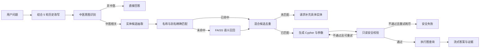

# 中医知识图谱问答开发基线

> 文档状态：开发基线 v0.1
>
> 适用阶段：可验证问答内核、API、会话流式与 Streamlit
> 最后更新：2026-10-28

本目录定义中医知识图谱问答第一版的开发范围、技术边界、接口契约、安全规则和验收标准。后续实现与评审以这些文档为基线，避免在开发过程中无依据地加入前端、微调、自动发布或额外检索基础设施。

## 项目目标

系统需要回答能够由当前中医知识图谱提供依据的问题，并让调用方看到：

- 识别出的中医问询意图。
- 从问题中抽取并成功链接到图谱的实体。
- 实际执行的只读 Cypher 和参数。
- 支持答案的图节点与关系证据。
- 查询无结果、模型异常或被安全策略拒绝时的明确状态。

第一版不追求“什么问题都能回答”，而是先保证有图谱依据的问题可以稳定回答，没有依据时不会编造。

## 当前基础

项目已经具备：

- 中药与方剂爬虫。
- 规则与大模型结合的实体关系抽取。
- Neo4j 批量导入。
- 带中文描述和实际三元组方向的图数据库元数据。
- pytest 测试基础设施。

当前图谱元数据以 [graph_metadata.json](../../metadata/graph_metadata.json) 和 [graph_metadata.md](../../metadata/graph_metadata.md) 为准。实体标签、属性、关系方向和三元组模式发生改变时，必须先重新导出元数据，再调整问答逻辑和测试。

## 当前实现范围

第一版包含：

- 中医意图识别。
- 实体候选抽取。
- 基于名称、别名和文本规范化的实体链接。
- Sentence-Transformers + FAISS 的混合实体语义召回。
- 最近 5 轮对话上下文的语义改写。
- 基于实际图元数据生成 Cypher 和查询参数。
- Cypher 只读安全校验、语法校验、超时和结果上限。
- Neo4j 查询执行。
- 基于查询结果生成带证据的回答。
- 命令行调用。
- FastAPI 非流式与 SSE 流式接口。
- Redis 多实例会话、限流和并发租约。
- Streamlit 双栏交互界面。
- 黄金问题集和可重复运行的评测脚本。
- 模拟 LLM、模拟 Neo4j 和可选真实 Neo4j 集成测试。

## 仍未实现

以下能力不进入本轮实现，也不作为本轮验收条件：

- 多用户、登录鉴权和权限系统。
- LoRA 微调、vLLM 部署和模型合并。
- 小红书、头条或其他平台的自动发布。
- 图谱写入、自动补图和新索引创建。
- 面向公众的在线医疗诊断或处方服务。

这些能力已经列入后续路线，只有在第一版评测通过并满足对应前置条件后才能启动。

## 目标流程

完整架构见 [architecture.md](architecture.md)，数据与接口契约见 [contracts.md](contracts.md)，安全及评测规则见 [security-and-evaluation.md](security-and-evaluation.md)。

M1 实现中遇到的问题、修复过程和遗留限制记录在 [implementation-challenges.md](implementation-challenges.md)。

## 开发阶段

| 阶段 | 目标 | 进入条件 | 完成标准 |
| --- | --- | --- | --- |
| M0 文档基线 | 冻结 MVP 范围和接口 | 用户确认文档计划 | 四份文档完成并检查通过 |
| M1 问答内核 | CLI 完成可验证问答 | M0 完成 | 单元测试、评测脚本和只读集成测试通过 |
| M2 API | 提供稳定 HTTP 契约 | M1 指标达到验收线 | 已完成多实例 FastAPI、鉴权、限流和测试 |
| M3 会话与流式 | 5 轮会话、FAISS 混合召回和 SSE | M2 完成 | 已完成单元、Redis 和真实会话/SSE 验证；真实向量模型需环境提供 |
| M4 交互界面 | Streamlit 进度与回答分栏 | M3 完成 | 已完成页面实测和安全输出 |
| M5 可选增强 | 微调与模型部署增强 | 基线证明存在明确收益 | 离线评测优于基线，可回滚 |

## 第一版 DoD

- 实现范围与本目录文档一致，没有额外加入非目标能力。
- Cypher 始终在只读会话中执行。
- 写操作、多语句、过程调用、变量长度路径和缺少 `LIMIT` 的查询被拒绝。
- 所有标签和关系类型必须存在于当前元数据。
- LLM 生成查询失败时最多重试两次。
- 没有图谱证据时，回答不得声称来自图谱。
- CLI 输出包含答案、实体、Cypher、参数、证据和稳定错误信息。
- pytest 全量通过。
- 黄金问题集可以重复运行并输出指标。
- 真实 Neo4j 集成测试可运行，或在服务不可用时明确标记为跳过。

## 文档变更规则

以下变化属于实质性变化，必须先更新文档并重新确认，再修改实现：

- 新增或移除实体标签、关系类型和查询模式。
- 改变实体唯一键或问答结果契约。
- 引入 FAISS、向量数据库、微调模型或其他核心依赖。
- 将 API、前端、多用户或内容发布纳入 MVP。
- 放宽 Cypher 安全规则。
- 允许回答使用图谱之外的事实作为主要依据。

实现与文档冲突时，以代码和实际图数据事实为准。发现冲突后应暂停相关开发，更新文档并记录原因。
