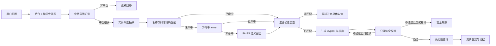

# 中医知识图谱问答开发基线

> 文档状态：开发基线 v0.1
>
> 适用阶段：可验证问答内核、API、会话流式与 Streamlit
> 最后更新：2026-10-28

本目录定义中医知识图谱问答当前实现的技术边界、接口契约、安全规则和验收标准，覆盖 CLI、FastAPI、SSE、Redis 会话、本地 FAISS 混合召回和 Streamlit。

## 项目目标

系统需要回答能够由当前中医知识图谱提供依据的问题，并让调用方看到：

- 识别出的中医问询意图。
- 从问题中抽取并成功链接到图谱的实体。
- 实际执行的只读 Cypher 和参数。
- 支持答案的图节点与关系证据。
- 查询无结果、模型异常或被安全策略拒绝时的明确状态。

系统不追求“什么问题都能回答”，而是保证有图谱依据的问题可以稳定回答，没有依据时不会编造。

## 当前基础

项目已经具备：

- 中药与方剂爬虫。
- 规则与大模型结合的实体关系抽取。
- Neo4j 批量导入。
- 带中文描述和实际三元组方向的图数据库元数据。
- LangGraph + Schema 约束 Text2Cypher 的只读问答工作流。
- 本地 BGE-large + FAISS 混合实体召回。
- FastAPI、SSE、Redis 会话和 Streamlit 客户端。
- pytest 测试基础设施。

当前图谱元数据以 [graph_metadata.json](../../metadata/graph_metadata.json) 和 [graph_metadata.md](../../metadata/graph_metadata.md) 为准。实体标签、属性、关系方向和三元组模式发生改变时，必须先重新导出元数据，再调整问答逻辑和测试。

## 当前实现范围

当前包含：

- 中医意图识别。
- 实体候选抽取。
- 基于名称、别名和文本规范化的实体链接。
- Sentence-Transformers + FAISS 的混合实体语义召回。
- 最近 5 轮对话上下文的语义改写。
- 属性事实和关系证据的统一回答上下文。
- 属性和唯一方向高频关系的确定性查询模板。
- 基于实际图元数据生成 Cypher 和查询参数。
- Cypher 只读安全校验、语法校验、超时和结果上限。
- Neo4j 查询执行。
- 基于查询结果生成带证据的回答。
- 命令行调用。
- FastAPI 非流式与 SSE 流式接口。
- Redis 多实例会话、限流和并发租约。
- Streamlit 双栏交互界面。
- 黄金问题集和可重复运行的评测脚本。
- 模拟 LLM、模拟 Neo4j 和可选真实 Neo4j 集成测试。

当前问答仍以显式关系证据为主。图谱中的性味、归经、用量、禁忌、主治、用法等属性虽然已经存在，但尚未统一进入回答证据链。

## 仍未实现

以下能力不在当前完成基线内：

- 多用户、登录鉴权和权限系统。
- 内容生成第三路由。
- LoRA 微调、vLLM 部署和模型合并。
- 小红书、头条或其他平台的自动发布。
- 图谱写入、自动补图和新索引创建。
- 面向公众的在线医疗诊断或处方服务。
- 基础聚合、多条件组合和复杂多跳查询。
- 200 条以上独立产品问题集和更大规模人工事实审核。
- 独立 Agent 拓扑。

当前本地运行以单 worker 为目标。多实例协调代码保留，但本地 BGE-large 会为每个 worker 重复占用模型内存，暂不作为本轮部署目标。

## 目标流程

上图描述当前已实现的以关系证据为核心的流程。属性查询、统一证据、答案审核和多轮质量升级的目标流程见
[product-quality-roadmap.md](product-quality-roadmap.md)。

完整架构见 [architecture.md](architecture.md)，数据与接口契约见 [contracts.md](contracts.md)，安全及评测规则见 [security-and-evaluation.md](security-and-evaluation.md)。

M1 实现中遇到的问题、修复过程和遗留限制记录在 [implementation-challenges.md](implementation-challenges.md)。

## 开发阶段

| 阶段 | 目标 | 进入条件 | 完成标准 |
| --- | --- | --- | --- |
| M0 文档基线 | 冻结 MVP 范围和接口 | 用户确认文档计划 | 四份文档完成并检查通过 |
| M1 问答内核 | CLI 完成可验证问答 | M0 完成 | 单元测试、评测脚本和只读集成测试通过 |
| M2 API | 提供稳定 HTTP 契约 | M1 指标达到验收线 | 已完成单 worker FastAPI、鉴权、限流和测试 |
| M3 会话与流式 | 5 轮会话、FAISS 混合召回和 SSE | M2 完成 | 已完成本地 BGE-large、真实 FAISS、Redis 会话和 SSE 验证 |
| M4 交互界面 | Streamlit 进度与回答分栏 | M3 完成 | 已完成页面实测和安全输出 |
| M5 可选增强 | 微调与模型部署增强 | 基线证明存在明确收益 | 离线评测优于基线，可回滚 |
| Q1 专业问答质量 v1 | 属性和关系统一证据、多轮上下文、答案审核 | 当前产品方向已确认 | 首轮完成；聚合、多跳和 200 条评测待扩展 |

## 当前验证状态

- 全量 pytest：166 passed、5 skipped。
- 黄金集：120 条；完整工作流 outcome 通过 116/120。
- 纯召回 Recall@3：100%；完整工作流实体 Recall@3：98.89%。
- 属性产品集：10/10 grounded，属性事实匹配率 100%。
- 多轮固定集：20 组 60 轮，outcome 和实体匹配均为 100%。
- 初始口径见 [实体召回路径评测报告](retrieval-evaluation-2026-10-28.md)。
- 最新修复结果见 [实体边界与 grounded 修复记录](retrieval-boundary-fix-2026-10-28.md)。
- 验收门槛与退出码见 [黄金集验收门槛说明](evaluation-acceptance-2026-10-28.md)。
- 本地演示运行与浏览器验收见 [本地演示版运行与验收](local-demo.md)。
- 11,043 实体完整 FAISS 首次构建约 10 分钟；缓存命中后启动约 7 秒。
- Streamlit 已完成真实浏览器测试：回答、进度、证据、追问和清空会话均正常。

### 专业问答质量 v1 首轮实施

2026-10-31 已完成首轮专业、可靠、可核对的产品问答升级：

1. 图谱属性已经进入回答上下文。
2. 属性和一跳正向/反向关系已经实现；基础聚合待扩展。
3. Redis 5 轮会话已通过 20 组、60 轮固定集。
4. 已增加首轮答案支持检查；更完整的人工事实审核待扩展。
5. 已增加 10 条属性集和 60 轮多轮集；200 条以上产品集待扩展。
6. 独立 Agent 演进继续放在质量契约稳定之后。

完整阶段、边界和验收计划见
[product-quality-roadmap.md](product-quality-roadmap.md)。
属性、一跳正向/反向和多轮固定集已经落地；基础聚合、多跳和 200 条以上独立评测仍待完成。详细结果见
[product-quality-validation-2026-10-31.md](product-quality-validation-2026-10-31.md)。

## M1 回归 DoD

- 实现范围与本目录文档一致，没有额外加入非目标能力。
- Cypher 始终在只读会话中执行。
- 写操作、多语句、过程调用、变量长度路径和缺少 `LIMIT` 的查询被拒绝。
- 所有标签和关系类型必须存在于当前元数据。
- LLM 生成查询失败时最多重试两次。
- 没有图谱证据时，回答不得声称来自图谱。
- CLI 输出包含答案、实体、Cypher、参数、证据和稳定错误信息。
- pytest 全量通过。
- 黄金问题集可以重复运行并输出指标。
- 真实 Neo4j 集成测试可运行，或在服务不可用时明确标记为跳过。

## 文档变更规则

以下变化属于实质性变化，必须先更新文档并重新确认，再修改实现：

- 新增或移除实体标签、关系类型和查询模式。
- 改变实体唯一键或问答结果契约。
- 替换嵌入模型、FAISS 排序策略、阈值语义或引入其他核心检索依赖。
- 新增 API、前端、多用户身份、内容生成或发布能力。
- 放宽 Cypher 安全规则。
- 允许回答使用图谱之外的事实作为主要依据。

实现与文档冲突时，以代码和实际图数据事实为准。发现冲突后应暂停相关开发，更新文档并记录原因。
