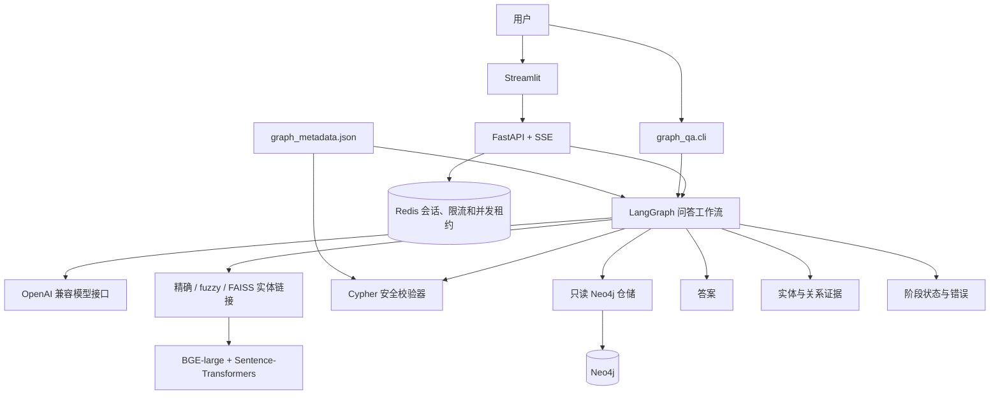
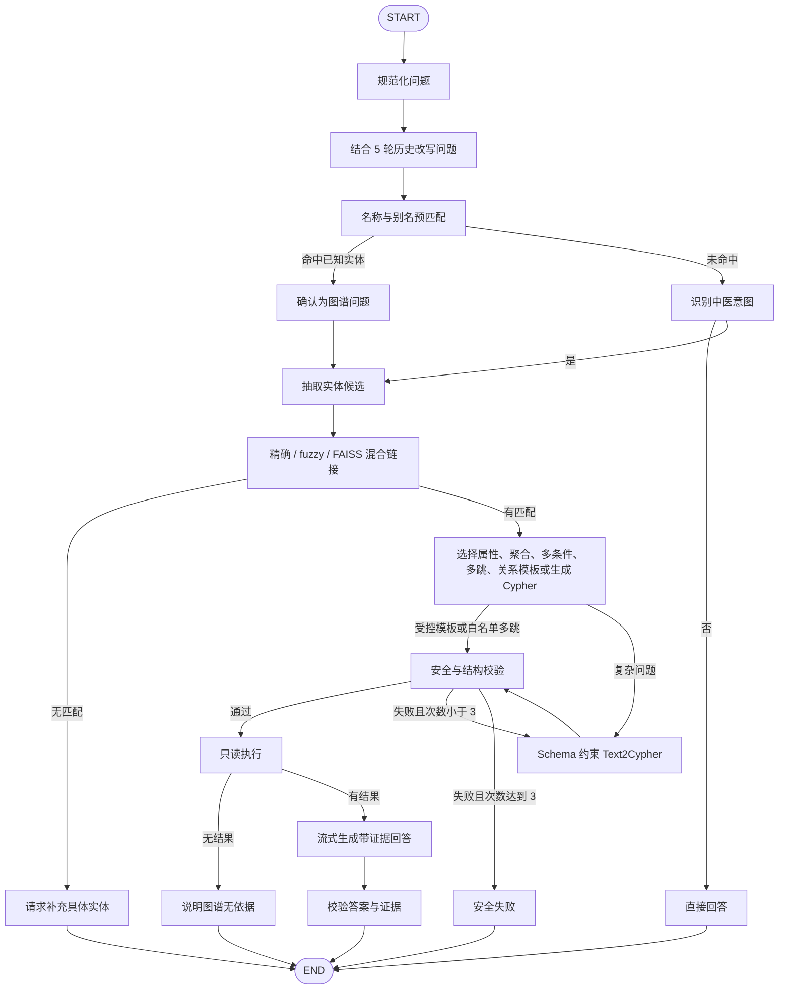
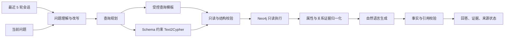

# 可验证知识图谱问答架构

> 文档状态：当前实现基线 v1.1
>
> 所属阶段：M1 问答内核、M2 API、M3 会话与流式、M4 Streamlit、查询扩展与 Agent 基础层
> 最后更新：2026-11-01

## 1. 架构目标

第一版采用“实体链接 + Schema 约束 Text2Cypher”的方案。系统的职责边界是：

1. 判断问题是否属于当前中医知识图谱可回答的范围。
2. 把用户口语转换为受控的图谱实体候选。
3. 使用当前图元数据约束大模型生成 Cypher。
4. 在执行前验证查询只读、结构合法、范围可控。
5. 只根据实际查询结果生成答案和证据。

它不是开放式医疗问答系统，也不是通用聊天机器人。图谱没有覆盖的问题必须明确返回未找到依据。

## 2. 系统上下文

### 外部依赖

- 大模型：通过现有 `MODEL_API_KEY`、`MODEL_BASE_URL`、`MODEL_NAME` 配置。
- Neo4j：通过现有 `NEO4J_URI`、`NEO4J_USER`、`NEO4J_PASSWORD` 配置。
- 嵌入模型：默认使用本地 `models/bge-large-zh-v1.5`。
- Redis：保存会话、限流窗口和全局并发租约。
- 图元数据：固定的 `metadata/graph_metadata.json`，运行前校验格式版本和关键字段。

外部依赖必须通过依赖注入或适配器隔离。默认测试不访问真实模型、数据库或 Redis；真实集成测试必须显式启用。

## 3. 模块划分

`graph_qa/` 当前模块：

| 模块 | 职责 | 明确不负责 |
| --- | --- | --- |
| `models.py` | 请求、意图、实体候选、属性/关系/聚合计划、事实、证据和结果模型 | 网络调用和业务路由 |
| `state.py` | LangGraph 状态定义和初始化 | 持久化会话 |
| `prompts.py` | 意图、实体抽取、Cypher 生成和回答提示词 | 读取数据库 |
| `agents/` | Agent 描述、唯一注册表、角色对象和阶段映射 | 改变 Cypher 安全边界或替代确定性查询 |
| `agents/evidence_audit.py` | 逐项证据覆盖、缺失来源统计和证据化回退 | 自由判断医学事实或放宽证据边界 |
| `entity_linker.py` | 名称规范化、别名索引、候选匹配 | 自行生成实体名称 |
| `cypher_guard.py` | 单语句、只读、元数据白名单、LIMIT 和参数检查 | 执行查询 |
| `neo4j_repository.py` | 元数据加载、图实体读取、属性/聚合模板、`EXPLAIN` 和只读查询 | 生成回答 |
| `workflow.py` | LangGraph 节点、查询规划、条件路由、答案校验和失败收口 | 暴露模型隐藏思维 |
| `semantic_index.py` | BGE-large 编码、FAISS Top-3 和索引缓存 | 决定图数据库事实 |
| `session_store.py` | 5 轮会话、TTL 和会话锁 | 保存完整执行状态 |
| `api.py` | FastAPI、SSE、错误映射和资源生命周期 | 复制工作流逻辑 |
| `streamlit_app.py` | 进度和回答分栏展示 | 业务校验和数据库访问 |
| `cli.py` | 参数解析、结果序列化和退出码 | 前端交互 |
| `evaluate.py` | 加载问题集、运行工作流、统计指标 | 修改图数据 |

模块应通过清晰的数据模型通信，不共享可变的全局字典。

## 4. 工作流

### 4.1 状态字段

工作流初始状态至少包含：

| 字段 | 含义 |
| --- | --- |
| `request_id` | 单次请求的唯一标识 |
| `question` | 用户原始问题 |
| `normalized_question` | 去空白和统一标点后的文本 |
| `conversation_history` | Redis 加载的最近 5 轮问题、回答和实体 |
| `rewritten_question` | 用于本轮后续步骤的独立、完整问题 |
| `session_id` | 当前对话标识，由 API 客户端作用域隔离 |
| `intent` | 结构化的领域意图与置信度，仅用于路由和诊断 |
| `entity_candidates` | 大模型抽取的实体候选 |
| `linked_entities` | 带 `label` 和 `name` 的图谱实体 |
| `attribute_plan` | 白名单属性查询计划 |
| `aggregate_plan` | 受控单跳或交集计数计划 |
| `multi_condition_plan` | 同时满足多个实体条件的结果列表计划 |
| `multi_hop_plan` | 仅包含两个步骤的白名单路径计划 |
| `cypher_plan` | Text2Cypher 候选查询和参数 |
| `validation_errors` | 安全或语法校验问题 |
| `query_attempts` | 已生成查询的次数 |
| `query_result` | 实际返回的受控查询结果 |
| `evidence` | 支持回答的实体、关系和来源 |
| `facts` | 支持回答的属性事实 |
| `aggregates` | 受控计数结果 |
| `paths` | 受控两跳的逐跳路径证据 |
| `verification` | 本轮回答审核状态、覆盖计数和来源统计 |
| `answer` | 最终回答 |
| `warnings` | 检索范围、模型降级等用户可见提示 |
| `error_code` | 稳定错误码 |
| `stage_events` | 可公开的工作流阶段，不包含隐藏推理 |

不存储或向前端返回模型内部思维链。需要解释过程时，只显示“识别意图”“匹配实体”“查询图谱”等可验证阶段。

### 4.2 Agent 角色与阶段注册

`QAAgentTeam` 通过 `AgentRegistry` 将固定 LangGraph 阶段映射到唯一 Agent。当前角色边界如下：

| Agent | 负责阶段 | 当前状态 |
| --- | --- | --- |
| `dialogue` | `normalize`、`rewrite_question` | 上下文相关追问通过角色对象调用改写模型，并提供历史降级 |
| `intent` | `prelink_entities`、`classify_intent` | 已知实体预匹配由确定性代码完成，未命中时通过角色对象分类 |
| `entity` | `extract_entities`、`link_entities` | 模型候选抽取通过角色对象完成，最终链接由确定性链接器确认 |
| `retrieval` | `plan_cypher`、`validate_cypher`、`execute_cypher` | 声明式职责边界；当前查询计划、Guard 和仓储执行仍由工作流确定性代码完成 |
| `answer` | `answer_from_graph`、`direct_answer` | 图谱回答和直接回答通过角色对象调用模型，失败时使用证据化降级 |
| `evidence_audit` | `verify_answer`、`clarify`、`no_evidence`、`safe_fail`、`finish` | 真实确定性 Agent；核对全部本轮证据并使用证据化回退，其余阶段仍由工作流收口 |

该注册表提供重复 Agent、重复阶段和未知阶段的明确错误。SSE `stage` 事件携带阶段对应的 `agent`，审核完成后另有 `audit` 事件。当前 LangGraph 仍是 16 个固定节点，不是独立 Agent 子图或动态调度系统。

### 4.3 路由

“重试上限 3”表示首次生成加最多两次重试。计数必须由固定状态字段控制，不能依赖递归自然结束。

## 5. 意图识别

意图识别只回答“当前问题是否属于本图谱可回答范围”，并输出结构化结果：

- `is_tcm_question`
- `confidence`
- `matched_domain_terms`
- `reason_code`

第一版不区分复杂子意图，也不让意图分类决定具体查询。具体查询由实体和元数据共同决定。

在调用模型前，系统先用本地名称和别名索引做确定性预匹配。命中已知图谱实体时，直接把问题视为图谱问题并标记 `KNOWN_GRAPH_ENTITY`；模型意图分类不得否定真实存在于图谱中的实体。未命中预索引时再调用模型分类。

非中医问题可以走大模型直接回答，但结果必须标记 `grounded=false`，并明确没有使用图谱证据。中医相关问题如果没有链接到任何图谱实体，优先请求用户补充具体药材、方剂、症状或疾病，不直接生成可能无依据的医疗建议。

## 6. 实体链接

### 6.1 索引来源

启动时通过只读查询加载所有实体：

- 标签：`Herb`、`Formula`、`Disease`、`Symptom`、`Effect`、`Source`
- 主键：`name`
- 可选别名：存在时的 `alias`

实体唯一键为 `(label, name)`。同名但标签不同的实体必须保持独立。

### 6.2 匹配顺序

1. 对用户文本和实体名称执行 Unicode NFKC、空白压缩和标点规范化。
2. 对名称和别名执行精确匹配。
3. 对提取出的短语执行规范化后精确匹配。
4. 使用受控的字符串相似度生成补充候选。
5. 同类候选按分数排序，保留有限数量并标记来源。

M1 使用 Python 标准库实现字符串相似度。当前 M3 扩展增加本地 BGE-large 和 FAISS，但不替代精确匹配和安全校验。

当前扩展在精确匹配和字符串模糊匹配之间加入语义召回：

1. 精确名称和别名仍优先。
2. 精确未命中时先执行字符串 fuzzy；达到阈值的词形匹配优先。
3. 字符串仍未命中时，Sentence-Transformers 编码实体名称、标签和别名。
4. FAISS 返回有限数量候选，默认 Top-3，并丢弃低于配置阈值的候选。
5. 最终仍按 `(label, name)` 去重并执行每标签数量限制。

向量索引只召回实体，不决定事实答案。事实仍必须来自实际 Cypher 查询和证据校验。

本地 `models/bge-large-zh-v1.5` 生成的完整 FAISS 索引缓存到 `.cache/graph_qa/faiss/`。实体集合或模型路径变化时缓存键变化并自动重建。

### 6.3 链接结果

每个匹配实体必须包含：

- `label`
- `name`
- `matched_text`
- `match_type`，例如 `name`、`alias` 或 `fuzzy`
- `score`

禁止只返回实体名称而丢失标签，否则 `Disease` 和 `Symptom` 等同名概念可能被错误合并。

## 7. Cypher 生成

提示词只使用实际导出元数据中的标签、属性和三元组模式。生成结果使用结构化模型：

- `cypher`
- `parameters`
- `used_entities`
- `expected_result_shape`

约束要求：

- 只生成一条查询。
- 只使用已链接实体及其标签。
- 只使用元数据中存在的属性和关系方向。
- 用户输入只能进入参数，不直接拼接到查询字符串。
- 必须包含明确的顶层 `LIMIT`。
- 不使用变量长度路径。
- 不使用过程调用、动态标签或元数据白名单之外的标识符。

具体校验规则见 [security-and-evaluation.md](security-and-evaluation.md)。

## 8. 查询执行

仓储层提供以下能力：

- `load_entity_index()`
- `explain(plan)`
- `execute_read(plan)`
- `execute_attributes(attribute_plan)`
- `execute_aggregate(aggregate_plan)`
- `execute_multi_condition_list(multi_condition_plan)`
- `execute_multi_hop(multi_hop_plan)`

查询在 Neo4j 只读会话中执行。仓储层再次检查标签和关系白名单，不能只依赖工作流前一步。

结果需要转换为稳定、可 JSON 序列化的记录，不能把 Neo4j 驱动对象直接返回给上层。

## 9. 回答生成

回答提示词只接收：

- 已规范化的用户问题。
- 成功链接的实体。
- 实际执行的查询。
- 实际返回的图记录。
- 可引用的关系证据。
- 可引用的属性事实。
- 可引用的受控聚合结果。
- 可引用的多条件结果对象。
- 可引用的两跳路径及其逐跳关系和来源。

回答遵循：

- 只陈述图谱结果支持的信息。
- 结果不足时明确说明没有找到依据。
- 涉及功效、主治、禁忌和用量时展示来源或证据标签。
- 不进行个体诊断，不给个性化处方。
- 不把模型常识伪装成图谱事实。
- 不输出模型隐藏推理过程。

如果查询成功但无结果，返回固定语义的“当前图谱没有找到相关依据”，不调用模型猜测答案。

回答生成后由 `EvidenceAuditAgent` 逐项检查回答是否覆盖本轮全部关系对象、属性值、聚合描述和路径节点；未完整覆盖或回答为空时替换为基于证据的简化回答。审核结果同时记录已核对/已匹配数量、缺失来源数和是否使用回退，并通过 API、SSE、CLI 和 Streamlit 展示。该检查是确定性文本覆盖，不宣称完成语义等价或医学事实审核。关系多来源会合并到同一条证据中展示。

## 10. 关键设计决策

| 决策 | 选择 | 原因 | 重新评估条件 |
| --- | --- | --- | --- |
| 检索方式 | 名称和别名优先 | 可解释、无需额外模型、当前规模可承受 | 黄金集 Recall@3 低于验收线 |
| 查询方式 | Schema 约束 Text2Cypher | 能利用实际关系结构并保留查询证据 | 查询正确率长期无法达标 |
| 写入权限 | 完全只读 | 防止提示词注入和误删数据 | 不计划放宽 |
| 重试次数 | 最多 3 次生成 | 控制延迟和模型成本 | 指标证明需要调整 |
| 多轮记忆 | M3 使用 Redis 保存最近 5 轮 | 控制持久化范围、隐私和上下文成本 | 需要端用户身份或更长记忆时 |
| 微调 | 不进入 M1 | 没有基线时无法证明收益 | 存在稳定训练集和基线差距 |
| 自动发布 | 不进入 MVP | 与问答目标无关且风险高 | 单独产品需求和安全评审 |

## 11. 已实现扩展与后续边界

### M2 API

FastAPI 只调用稳定的问答服务接口，不复制工作流逻辑。接口必须包含请求模型、错误码、超时和健康检查。

当前已实现非流式接口、API Key、Redis 限流、全局并发和错误映射。

### M3 记忆与流式

- 使用 Redis 持久化裁剪后的最近 5 轮会话上下文。
- 会话作用域为 `(client_id, session_id)`；不把 API Key 直接当会话 ID。
- `rewrite_question` 节点结合历史消解“它、该药”等指代。
- 同一会话通过 Redis 锁串行执行，不同会话可以并行。
- 使用 LangGraph `StreamWriter` 和请求级 SSE，不使用全局用户队列。
- 推送公开的工作流阶段、证据和答案 token，不推送隐藏推理。

当前已实现 Redis 会话、语义改写、本地 BGE-large + FAISS 混合召回和 SSE。

### M4 前端

Streamlit 客户端调用 SSE 接口，分栏展示公开处理进度、逐 token 回答和图谱证据。界面不使用不受控 HTML，并显示医学免责声明。

当前已完成浏览器实测。

### M5 微调与部署增强

向量检索已作为 M3 能力实现。后续微调仍必须提供训练集、验证集、独立测试集和基线对比，微调目标只针对受限任务，不用于替代图谱证据。

小红书或其他内容发布属于独立工作流，必须在人工确认、平台合规和内容审核存在后才能实现。

## 12. 专业问答产品演进方向

> 状态：首轮实现完成，持续扩充评测与查询覆盖
>
> 规划与验收记录：[product-quality-roadmap.md](product-quality-roadmap.md)

2026-10-30 已完成专业问答质量 v1 的首轮实现：图谱属性进入回答上下文，高频关系问题使用确定性模板，失败轮次不再产生不可用会话，最终答案增加证据支持检查。

目标态不是放宽现有安全边界，而是在现有边界内增加受控能力：

当前已实现的能力边界：

- 属性事实和关系事实使用不同但可组合的受控查询模式。
- 属性型问题不再被强制构造成不存在的图关系。
- 明确的单跳或多条件交集计数问题使用受控 Schema 模板，不允许模型自由生成聚合。
- “同时满足多个实体条件”的列表问题使用多个 `EXISTS` 固定模板，返回结果节点、命中关系和来源。
- 两跳查询只允许 Schema 中存在且明确列入白名单的路径；每一跳都必须连续，并返回完整 `PathEvidence`。
- 查询规划优先使用经过测试的模板，Text2Cypher 只作为受限回退。
- 最终回答生成后增加事实与引用校验。
- 多轮上下文支持指代消解、实体继承、话题切换、用户纠正和失败轮次隔离。
- 图谱没有来源时明确输出“当前图谱未提供出处”。

当前多轮上下文继续以 Redis 最近 5 轮记录为基础，并增加了确定性主题切换：

- 会话记录包含问题、最终回答、已链接实体、grounded 状态、成功或失败状态和时间戳。
- 可以增加最小化的活动主题和待澄清状态，但不能保存模型隐藏推理。
- 新明确实体优先作为当前主题，避免错误继承旧实体。
- 指代或省略不唯一时必须澄清。
- 失败轮次不得覆盖最近一次有效主题，前端也不得保留服务端不存在的会话 ID。
- 第 6 轮裁剪、TTL、主动清空和跨会话隔离必须进入固定回归测试。

仍需继续完善：

- 任意深度、任意关系组合和由模型动态规划的复杂多跳查询。
- 更大规模、独立真实问题的属性与多轮评测集。
- 人工或规则化的答案关键事实准确率评估。
- 检索规划 Agent 的独立输入输出契约、拓扑和动态调度。
- 回答审核的语义等价判断和大规模人工事实抽检。

实现必须保持以下不变量：

- Neo4j 始终只读执行。
- 标签、关系、属性、参数、结果上限和超时继续受控。
- 回答事实必须来自本轮图谱结果。
- 不向用户暴露模型隐藏推理。
- 失败请求不得污染下一轮会话。
