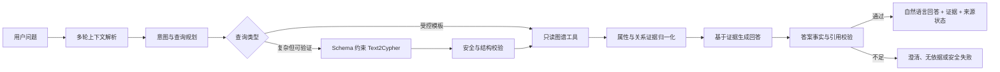

# 专业中医图谱问答产品质量路线图

> 文档状态：专业问答质量 v1 首轮落地
>
> 决策日期：2026-10-30
>
> 当前基线：本地演示版、单 worker、FastAPI + Streamlit
>
> 产品定位：基于真实图谱证据的中医药知识问答，不提供在线诊断或处方

本文用于校准产品目标、记录当前质量缺口，并约束后续“专业问答质量 v1”的开发与验收。各阶段会明确标记已完成和仍待实现内容，未标记完成的能力不得对外宣称已交付。

## 1. 已确认方向

1. 当前主线是专业、可靠、可核对的中医药知识问答产品。
2. 回答必须优先使用真实图谱事实；大语言模型负责理解问题和组织自然语言，不承担事实来源职责。
3. 多轮上下文属于产品 v1 的正式能力，不只作为演示功能。
4. 保留现有只读查询、安全校验、证据和会话隔离边界。
5. 不实现小红书、图片生成、自动发布等内容生成路由。
6. 多智能体是后续架构演进方向，不是当前产品质量修复的前置条件。

## 2. 当前事实基线

### 2.1 图谱规模

2026-10-30 对当前 Neo4j 进行只读核对：

| 项目 | 当前值 |
| --- | ---: |
| 节点总数 | 11,043 |
| 关系总数 | 26,324 |
| 实体标签 | 6 |
| 关系类型 | 6 |
| 元数据三元组模式 | 14 |

节点分布：

| 标签 | 节点数 |
| --- | ---: |
| `Symptom` | 2,905 |
| `Disease` | 2,863 |
| `Herb` | 2,359 |
| `Effect` | 1,046 |
| `Formula` | 1,020 |
| `Source` | 850 |

### 2.2 专业属性数据

当前图中有大量未进入问答证据链的属性事实：

| 对象 | 总量 | 已有属性 |
| --- | ---: | --- |
| `Herb` | 2,359 | 性味 1,466、归经 1,236、用量 1,219、禁忌 851、主治 1,412、功效字段 1,465 |
| `Formula` | 1,020 | 主治 741、功效字段 619、用法 604、禁忌 134 |

以“麻黄”为例，图谱已有性味、归经、用量、功效、主治和禁忌字段，但当前问答主路径主要依赖关系证据，无法稳定把这些属性作为回答上下文返回。

### 2.3 来源覆盖

| 对象 | 有 `FROM_SOURCE` 来源 | 总量 | 覆盖率 |
| --- | ---: | ---: | ---: |
| `Herb` | 412 | 2,359 | 17.5% |
| `Formula` | 720 | 1,020 | 70.6% |

没有来源关系不代表内容一定不可靠，但产品必须显式显示“当前图谱未提供出处”，不能隐式暗示已经完成医学证据审核。

### 2.4 当前问答与评测

- 当前 LangGraph 工作流包含 16 个节点。
- 已实现精确名称、别名、fuzzy 和 BGE + FAISS 实体召回。
- 关系查询仍以单三元组路径和固定证据字段为核心。
- Redis 已支持最近 5 轮问题、回答、已链接实体和 grounded 状态。
- 当前全量测试为 180 passed、5 skipped。
- 当前 120 条固定评测 outcome 为 117/120，完整工作流实体 Recall@3 为 98.89%。
- 原 120 条评测仍未覆盖属性事实，也没有显式 `no_evidence` 用例。

### 2.5 2026-10-31 首轮落地

已新增独立属性产品集和多轮固定集：

- 属性与聚合产品集：16/16 grounded，属性事实匹配率 100%，聚合匹配率 100%，P95 约 0.4 秒。
- 多轮固定集：20 组、62 轮，outcome 和实体匹配均为 100%。
- 原 120 条回归：117/120，Cypher、查询执行、安全和 grounded 覆盖率通过门槛。
- 浏览器已验证属性展示和“它有什么禁忌”多轮追问。

详细结果见
[product-quality-validation-2026-10-31.md](product-quality-validation-2026-10-31.md)。

## 3. 本轮前质量问题与处理状态

### 3.1 属性事实没有进入回答上下文

当前 Cypher 校验要求查询至少包含显式关系三元组，并返回固定关系证据字段。这保证了证据结构统一，但会拒绝或漏掉只依赖节点属性的问题，例如：

- 麻黄性味归经是什么？
- 麻黄有哪些禁忌和用量？
- 四君子汤的用法是什么？

图谱中有答案，产品层却没有把答案送入最终回答上下文。

处理状态：已实现属性和关系独立的证据结构，麻黄性味、归经、用量、禁忌等属性可以进入回答和前端展示。

### 3.2 查询类型覆盖不足

当前单三元组路径可以覆盖基础功效、组成、症状和来源问题，但对以下问题覆盖不足：

- 属性查询。
- 反向查询。
- 多条件筛选。
- 简单聚合和计数。
- 多跳关系。
- 同一问题的多个证据组合。

处理状态：属性查询、一跳正向/反向关系、单跳计数已实现；多条件组合和复杂多跳仍未实现。

### 3.3 评测不能代表产品回答质量

现有评测主要验证实体召回、Cypher 通过、查询执行和 grounded 关系证据，尚未系统评估：

- 图谱事实是否完整进入答案。
- 答案中的关键事实是否都能对应证据。
- 答案是否加入证据之外的内容。
- 属性问题是否被正确理解和回答。
- 无来源内容是否被正确标注。
- 连续 5 轮追问是否保持一致。

处理状态：新增属性/聚合产品集和多轮固定集；更大规模的 200 条独立产品集仍需后续建设。

### 3.4 多轮上下文仍处于基础能力阶段

本轮前 Redis 和问题改写已经建立，但产品级验收尚未完成。

处理状态：已修复新会话初始化和失败轮次会话 ID 问题；20 组、62 轮固定集通过。更长上下文和跨端用户身份仍不在当前范围。

### 3.5 回答缺少独立审核

当前回答由模型在真实查询结果基础上生成，但生成后主要依靠 prompt 和 grounded 标志约束。产品 v1 需要将“组织语言”和“核对最终答案”分开，至少检查：

- 答案中的专业事实是否来自本轮证据。
- 是否遗漏关键来源或“无来源”提示。
- 是否出现图谱未提供的剂量、禁忌或疗效。
- 证据不足时是否明确拒答或澄清。

处理状态：已增加确定性答案支持检查，不支持证据的回答会替换为证据化回答；更完整的专业事实审核仍待后续。

## 4. 产品 v1 查询能力

产品 v1 优先覆盖图谱中已有、能够稳定验证的问题类型：

| 类型 | 示例 | 目标 |
| --- | --- | --- |
| 属性查询 | 麻黄性味、归经、用量、禁忌、用法 | 从节点受控属性读取 |
| 一跳关系 | 麻黄有哪些功效 | 保留现有关系证据 |
| 反向关系 | 哪些方剂含有人参 | 从目标实体反向匹配 |
| 组成与症状 | 四君子汤由什么组成、疾病有哪些症状 | 返回结构化列表 |
| 来源查询 | 四物汤出自哪些文献 | 返回来源或明确无来源 |
| 简单聚合 | 含人参的方剂有多少 | 已实现单跳计数，仅允许受控聚合模式 |
| 多轮追问 | 它有什么禁忌、这个方剂怎么用 | 结合最近 5 轮上下文 |
| 无证据问题 | 图谱不存在的实体或关系 | 诚实说明并请求补充 |

第一版不承诺完整支持多跳推理、开放世界医疗问答或复杂分析型查询。新增模式必须同步元数据、契约、测试和评测。

## 5. 多轮上下文产品要求

### 5.1 上下文范围

保留 Redis 最近 5 轮会话，不保存完整 LangGraph 检查点、Cypher、完整查询行、模型提示词和错误堆栈。

每轮至少保存：

- 用户问题。
- 最终回答。
- 已链接实体。
- grounded 状态。
- 时间戳。

只有 `error == null` 的成功轮次写入历史。失败轮次不污染上下文，但空会话仍可继续使用。产品级实现可以增加最小化的活动主题和待澄清状态，但不得保存隐藏推理。

### 5.2 必须支持的行为

1. 指代消解：把“它、该药、这个方剂”解析到最近有效实体。
2. 省略继承：用户省略主语时，在无歧义前提下继承上一轮主题。
3. 关系切换：同一实体从“功效”追问到“禁忌、用量、来源”时保持实体不变。
4. 话题切换：出现新的明确实体时，以新实体为当前主题，不错误继承旧实体。
5. 用户纠正：用户说“不是麻黄，是桂枝”时，以新实体重新执行。
6. 歧义澄清：历史中无法唯一确定指代时，请求用户补充，不猜测。
7. 失败轮次隔离：失败请求不得污染下一轮上下文，也不得留下不可用会话 ID。
8. 过期与清除：会话 TTL、主动清空和第 6 轮裁剪行为明确且可测试。

### 5.3 多轮质量验收

至少建立 20 组、每组 3 至 5 轮的固定对话用例，覆盖：

- 同实体连续追问。
- 跨实体切换。
- 指代和省略。
- 用户纠正。
- 无结果后的继续追问。
- 安全拒绝后的恢复。
- 清空会话。
- 超过 5 轮后的裁剪。
- 非中医直接回答后回到图谱问题。

多轮上下文准确率建议不低于 90%，失败轮次隔离和跨会话隔离必须为 100%。

当前实测：20 组、62 轮 outcome 和实体匹配均为 100%，`acceptance.passed=true`。

## 6. 目标链路

核心链路、单跳聚合和多条件计数已实现；多条件结果列表与复杂多跳仍是目标态：

关键原则：

- 查询规划优先使用受控模板，Text2Cypher 只作为白名单校验后的回退路径。
- 属性查询和关系查询使用统一、可追溯的证据模型。
- 回答生成和答案审核解耦。
- 多轮改写不得产生历史中不存在的事实。
- 安全校验、只读执行和证据校验始终由确定性代码完成。

## 7. 实施阶段

### P0 文档基线

状态：已完成。

目标：冻结产品方向、当前缺口和后续验收标准。

完成标准：

- 产品质量路线图发布。
- 架构、评测、问题记录和交接文档同步。
- 明确当前已实现能力和计划能力。

### P1 查询覆盖与证据归一化

状态：首轮完成；单跳和多条件计数已落地，多条件结果列表和复杂多跳待后续。

目标：让图谱中已有的属性和关系事实都能进入回答上下文。

工作范围：

- 定义属性证据和关系证据的统一结构和公开契约。
- 建立高频问题查询目录和受控模板。
- 支持属性、一跳正向、反向和基础聚合。
- 保留 Text2Cypher 回退与现有安全边界。
- 增加无来源事实的用户可见状态。

完成标准：

- 属性问题可以稳定取得图谱字段。
- 关系问题不回归。
- 每类查询有正常、空结果、来源缺失和安全边界测试。

### P2 多轮上下文 v1

状态：首轮完成，20 组、62 轮固定集通过。

目标：把现有 Redis 5 轮基础能力升级为可交付的多轮问答。

工作范围：

- 修复失败轮次与会话 ID 不一致问题。
- 明确活动主题、实体继承和话题切换规则。
- 完善指代、纠正和歧义澄清。
- 增加 5 轮固定对话评测和浏览器交互验证。

完成标准：

- 多轮上下文准确率达到门槛。
- 失败轮次隔离和会话作用域隔离为 100%。
- 第 6 轮裁剪、TTL 和清空行为稳定。

### P3 回答审核与质量评测

状态：首轮完成；答案支持校验、属性集和多轮集已落地，200 条以上产品集仍待扩充。

目标：从“有证据”升级为“答案中的事实可由证据支持”。

工作范围：

- 增加关键事实与证据的对应检查。
- 增加来源或“图谱未提供来源”提示。
- 增加无依据、证据不足和医疗安全边界测试。
- 将评测集扩充到至少 200 条，覆盖属性、关系、反向、聚合和多轮。

完成标准：

- grounded 回答引用覆盖率为 100%。
- 无证据诚实率为 100%。
- 答案关键事实准确率建议不低于 95%。
- 不允许将另一个大模型评分作为唯一验收依据。

### P4 独立 Agent 演进

状态：未开始。

目标：在查询、证据和会话契约稳定后，再抽象问题理解、检索规划、证据审核和回答组织角色。

进入条件：

- P1 至 P3 的主要指标稳定。
- 有明确证据表明模块边界或协作方式成为进一步改进瓶颈。

独立 Agent 不应取代只读查询、Cypher Guard、权限和证据校验等确定性能力。

## 8. 质量门槛

产品 v1 建议门槛与当前首轮结果：

| 指标 | 建议门槛 | 当前结果 |
| --- | ---: | --- |
| 属性问题成功回答率 | ≥ 90% | 100%，10 条属性集 |
| 属性事实匹配率 | ≥ 90% | 100%，10 条属性集 |
| 单跳/多条件聚合匹配率 | ≥ 90% | 100%，6 条聚合集 |
| grounded 回答引用覆盖率 | 100% | 100% |
| 无证据诚实率 | 100% | 已有单点用例通过，大规模仍待评测 |
| 无来源披露率 | 100% | 浏览器已人工验证，自动指标待补 |
| 多轮上下文准确率 | ≥ 90% | 100%，20 组 62 轮 |
| 失败轮次隔离率 | 100% | 单元和真实多轮场景通过 |
| 跨会话隔离率 | 100% | 单元覆盖；真实集成测试需显式启用 |
| 危险查询拦截率 | 100% | 100% |

没有样本的指标必须标记为 `not_evaluated`，不能视为通过。

## 9. 非目标与风险

### 9.1 非目标

- 不生成小红书、文章、图片或自动发布内容。
- 不提供在线医疗诊断、个性化处方或剂量建议。
- 不以多 worker 作为本地产品验收目标。
- 不因提升回答覆盖率而放宽只读、参数化或证据边界。

### 9.2 主要风险

- 属性字段存在空值、格式不统一或语义重复。
- 来源覆盖不完整，不能把所有回答都包装成“循证结论”。
- 放宽查询模板后可能引入越权查询或无关证据。
- 多轮上下文可能被失败请求、歧义指代或话题切换污染。
- 固定评测集过拟合；需要持续加入真实问题和独立回归集。

### 9.3 决定

- 保留当前 FastAPI、Streamlit、Redis、LangGraph、Neo4j、BGE + FAISS 和 Cypher Guard。
- 参考项目只作为业务原型和数据流程参考，不复制其原始 Cypher 执行、内存队列、固定用户 ID 或内容生成分支。
- 当前产品优先解决事实覆盖、答案审核和多轮上下文，再做 Agent 拓扑演进。

### 9.4 参考项目取舍

参考项目值得借鉴的部分：

- 中药材、方剂、元数据、Neo4j 和向量索引的领域流程。
- 将意图识别、实体抽取、实体匹配、查询生成、查询执行和回答组织拆成明确节点的思路。
- 从前端展示公开处理阶段的交互方式。

不进入当前产品的部分：

- 小红书文案、图片生成、自动发布、Cookie 和平台相关依赖。
- 直接执行模型生成的完整 Cypher。
- 仅用 `EXPLAIN` 代替只读和结构安全校验。
- 模块导入时连接数据库、加载模型和索引的副作用。
- 以固定用户 ID 和进程内队列承载会话与流式消息。
- 没有自动化测试、重试上限和可靠失败收口的实现。

当前项目已经具备更严格的安全、契约、证据、会话和测试基础，因此不整体替换为参考项目。

## 10. 变更控制

以下变化必须先更新本文和相关契约，再进入实现：

- 查询模式、证据字段或公开响应结构变化。
- 允许的关系路径、属性白名单或聚合方式变化。
- 会话保存字段、TTL、裁剪和失败轮次语义变化。
- 新增答案审核状态或来源展示字段。
- 将独立 Agent 作为交付目标。
