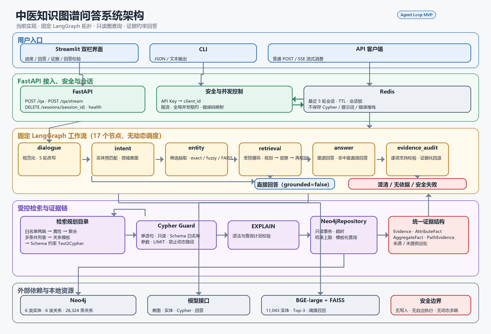
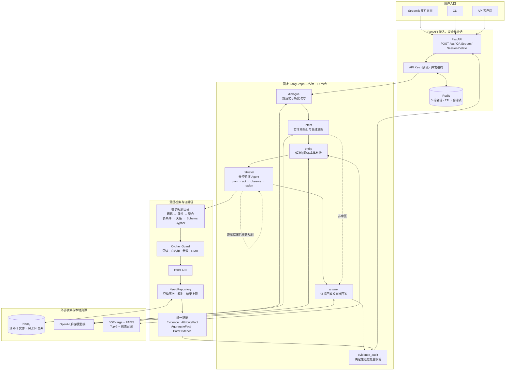
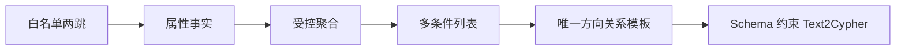

# 项目架构图

> 当前阶段：受控单 Agent 闭环 MVP
>
> 图示范围：本地单 worker、固定 LangGraph 拓扑、只读 Neo4j 查询



## 1. 总体架构



## 2. Agent 现状

| Agent | 当前实现 | 是否独立子图 |
| --- | --- | --- |
| `dialogue` | 模型调用角色封装，负责上下文改写并支持历史降级 | 否 |
| `intent` | 确定性实体预匹配 + 模型领域意图分类 | 否 |
| `entity` | 模型候选抽取 + 确定性 exact/fuzzy/FAISS 链接 | 否 |
| `retrieval` | 真实受控闭环 Agent，有独立契约并执行规划、观察和预算内重规划 | 否 |
| `answer` | 模型回答角色封装，失败时使用证据化回答 | 否 |
| `evidence_audit` | 真实确定性 Agent，逐项证据覆盖并回退 | 否 |

当前所有 Agent 都运行在固定 LangGraph 主拓扑中。`retrieval` 已具备 `plan → act → observe → replan` 闭环，`retrieval` 和 `evidence_audit` 都是实际可测试 Agent；但还没有为每个 Agent 编译独立子图，也没有动态 Agent 调度。

## 3. 检索规划顺序



`RetrievalAgent` 只输出上述计划之一，不持有 Cypher Guard 或仓储，不能执行查询。查询必须继续经过 Guard、`EXPLAIN`、只读仓储和确定性证据归一化。

## 4. 安全与证据不变量

- Neo4j 始终在只读会话中执行。
- 不接受任意 Cypher、模型自治执行、动态路径或变量长度路径。
- 用户输入只能通过查询参数传入。
- grounded 回答必须包含本轮真实图谱证据。
- 未知实体只澄清，不生成医疗事实。
- 无依据时明确说明；无来源时显示“未提供出处”。
- 回答审核使用确定性覆盖检查，不暴露模型隐藏推理。

## 5. 重新生成图片

```powershell
uv run python scripts/render_architecture_diagram.py
```

输出文件：

```text
docs/graph_qa/assets/project-architecture.png
```
