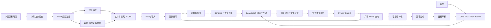
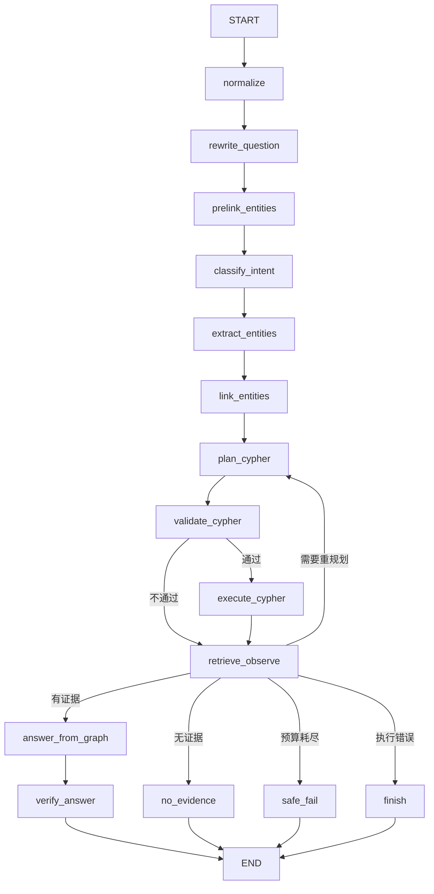
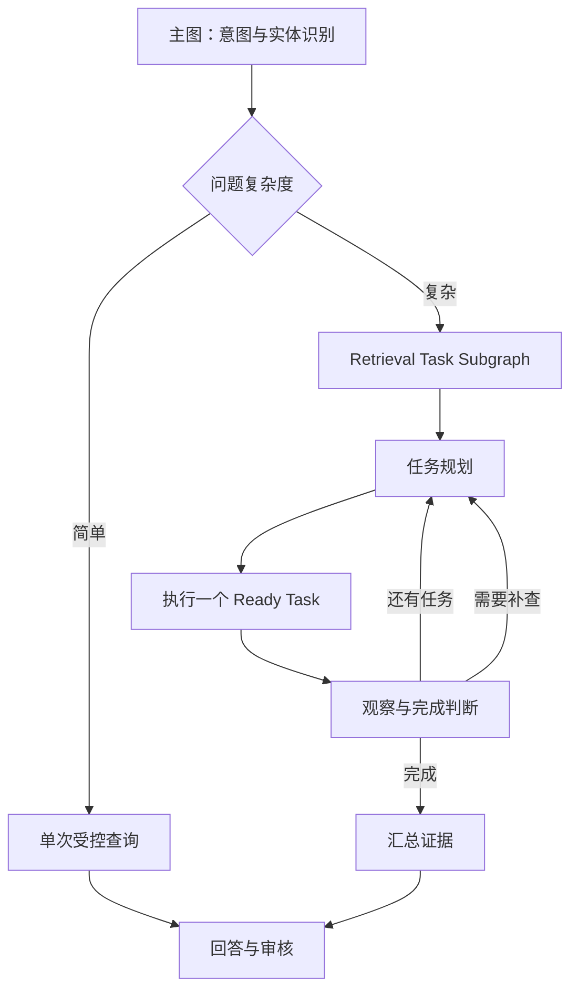

# 中医知识图谱项目：实现理解与面试准备指南

> 适用范围：快速熟悉当前仓库、理解核心实现、准备项目面试
>
> 代码基线：`codex/product-quality-v2`
>
> 整理日期：2026-11-06
>
> 说明：本文依据当前代码和仓库内验收文档整理。文中的性能、测试和评测数字属于仓库已有验收记录，不代表本次文档编写时重新执行的实时结果。

## 目录

1. [先看结论：这个项目是什么](#1-先看结论这个项目是什么)
2. [项目全貌](#2-项目全貌)
3. [数据生产链路](#3-数据生产链路)
4. [图模型与元数据](#4-图模型与元数据)
5. [问答工作流实现](#5-问答工作流实现)
6. [关键模块逐个理解](#6-关键模块逐个理解)
7. [Agent 能力如何实现](#7-agent-能力如何实现)
8. [主要难点与设计考量](#8-主要难点与设计考量)
9. [安全、可靠性和证据链](#9-安全可靠性和证据链)
10. [测试与评测体系](#10-测试与评测体系)
11. [当前限制与下一步设计](#11-当前限制与下一步设计)
12. [面试项目介绍模板](#12-面试项目介绍模板)
13. [面试案例库](#13-面试案例库)
14. [常见追问与参考回答](#14-常见追问与参考回答)
15. [高效阅读代码路线](#15-高效阅读代码路线)
16. [术语表与自测清单](#16-术语表与自测清单)
17. [源码与权威文档索引](#17-源码与权威文档索引)

---

## 1. 先看结论：这个项目是什么

### 1.1 一句话概括

这是一个从网页采集中医药数据，经过规则和大模型抽取形成知识图谱，再通过 LangGraph 编排、实体链接、受控查询规划、Neo4j 只读检索和证据审核来回答中医知识问题的系统。

更完整的定位是：

> 一个面向中药、方剂、疾病、症状、功效和文献来源的可验证知识图谱问答系统。

### 1.2 它解决的核心问题

用户用自然语言提问，例如：

```text
麻黄性味归经是什么？
四君子汤由哪些药材组成？
含有人参的方剂有多少种？
四君子汤所含药材有什么功效？
同时含有人参和白术的方剂有哪些？
```

系统需要完成：

1. 判断问题是否在中医图谱范围内。
2. 识别问题中的实体。
3. 把口语实体链接到图谱中的 `(label, name)`。
4. 选择受控查询计划。
5. 生成或构造 Cypher。
6. 校验查询只读、合法、范围受限。
7. 在 Neo4j 中执行查询。
8. 把结果转换成可核对证据。
9. 只基于证据生成回答。
10. 检查回答是否覆盖全部证据。
11. 明确表达“无实体”“无证据”“无来源”或“安全拒绝”。

### 1.3 它不是什么

面试时要主动讲清边界：

- 不是通用聊天机器人。
- 不是开放式在线医疗诊断系统。
- 不允许模型直接执行任意数据库命令。
- 不是任意深度、任意关系的动态多跳系统。
- 不是多 Agent 自治协作系统。
- 不是只靠向量库的 RAG，而是知识图谱加受控 Text2Cypher。

### 1.4 最准确的技术定位

| 维度 | 当前定位 |
| --- | --- |
| 应用类型 | 中医知识图谱问答 |
| 检索方式 | 实体链接 + 受控模板 + Schema 约束 Text2Cypher |
| 编排方式 | LangGraph `StateGraph` 固定主图 |
| Agent 程度 | 有界单 Agent 闭环 |
| 查询权限 | 只读 |
| 回答约束 | 必须由本轮图谱证据支持 |
| 服务形态 | CLI、FastAPI、SSE、Streamlit |
| 记忆方式 | Redis 最近 5 轮会话 |

可以用一句话回答“算不算 Agent”：

> 系统整体是 Agentic RAG，检索部分具备受控单 Agent 闭环；主图拓扑、工具集合和大部分重规划决策仍由代码约束，因此不是通用自主 Agent，更不是多 Agent 系统。

---

## 2. 项目全貌

### 2.1 端到端架构



### 2.2 七个主要层次

| 层次 | 主要模块 | 职责 |
| --- | --- | --- |
| 数据采集 | `crawler/` | 抓取网页、限速、断点续爬、导出 Excel |
| 知识抽取 | `extract_information/` | 规则和 LLM 结合抽取实体、属性、关系 |
| 图数据库 | `graph_database/` | 幂等导入、约束、端点补全、元数据导出 |
| 图约束 | `metadata/`、`graph_qa/schema.py` | 标签、属性、关系和三元组白名单 |
| 问答核心 | `graph_qa/` | 编排、实体链接、规划、校验、执行、回答、审核 |
| 服务与界面 | `api.py`、`streamlit_app.py`、`cli.py` | HTTP、SSE、会话、交互页面 |
| 质量保障 | `tests/`、`evaluation/` | 单元测试、集成测试、固定集评测 |

### 2.3 技术栈

- Python 3.12+
- LangGraph 1.0.9
- LangChain 1.2.10
- OpenAI 兼容模型接口
- Neo4j 6.1.0
- Pydantic 2
- FastAPI + SSE
- Redis
- Sentence-Transformers
- BGE-large-zh-v1.5
- FAISS
- Streamlit
- pytest

### 2.4 当前图数据概况

仓库验收记录中的图规模：

- 约 11,043 个实体节点。
- 约 26,324 条关系。
- 6 类实体标签。
- 6 类关系类型。
- 14 种实际三元组方向模式。

核心实体类型：

```text
Herb
Formula
Disease
Symptom
Effect
Source
```

核心关系类型：

```text
TREATS_DISEASE
ALLEVIATES_SYMPTOM
HAS_EFFECT
HAS_INGREDIENT
HAS_SYMPTOM
FROM_SOURCE
```

---

## 3. 数据生产链路

### 3.1 网页采集

爬虫位于：

- `crawler/zhongyao_spider.py`
- `crawler/fangji_spider.py`

主要实现：

1. 请求前检查 `robots.txt`。
2. 使用自定义 `User-Agent` 标识机器人。
3. 默认单线程串行抓取。
4. 每次请求之间随机等待 1 至 2 秒。
5. 设置连接/读取超时和有限重试。
6. 每抓完一条立即追加到 JSONL 缓存。
7. 进程中断后从缓存继续，不重复请求已完成页面。
8. 单条解析失败记录到失败清单，不终止整批任务。
9. 将结构化结果导出为带格式的 Excel。

详情页解析不是简单选择器，而是一个小型状态机：

- `h2` 决定大章节，如功效、炮制、药方。
- `h3`/`h4` 在章节内细分为字段。
- 无法识别的标题归入“其他信息”，避免数据直接丢失。
- 方剂组成优先读取链接和正文，对剂量、括号注释和剂型词做清洗。

### 3.2 知识抽取

入口为 `extract_information/extract_info.py`。

总体策略：

```text
表格中已经结构化的字段 → 规则映射
“主治”这类长文本     → LLM 识别疾病和症状
关系头尾             → 程序根据当前药材/方剂确定
```

这种设计避免让大模型同时决定“主实体、关系、客体和属性”，减少幻觉和不可复现性。

规则抽取包括：

- 方剂组成切分。
- 剂量与括号注释清理。
- 出处书名提取。
- 功效短语切分。
- 药材和方剂字段映射。
- 噪声词、剂型词和植物学描述过滤。

LLM 抽取只输出：

```json
{
  "diseases": [],
  "symptoms": []
}
```

随后程序生成：

```text
Herb -> TREATS_DISEASE -> Disease
Herb -> ALLEVIATES_SYMPTOM -> Symptom
Formula -> TREATS_DISEASE -> Disease
Formula -> ALLEVIATES_SYMPTOM -> Symptom
```

这样关系方向由代码保证，不依赖模型自由发挥。

数据工程处理：

- 每条记录成功后立即写 JSONL。
- 以 `kind + name + url` 作为断点续跑键。
- 失败记录单独保存，可再次运行补抽。
- LLM 调用使用有限线程池并发。
- 文件写入集中在主线程，避免并发写乱序。
- 最终按 `(type, name)` 合并实体。
- 关系按 `(subject, relation, object)` 去重。
- 同一个属性字段保留第一个非空值。

### 3.3 Neo4j 导入

入口为 `graph_database/import_data.py`。

关键策略：

1. 实体唯一键是 `(label, name)`。
2. 每个标签使用独立唯一约束。
3. 实体使用 `MERGE`，属性通过 `SET node += row.attributes` 更新。
4. 关系使用固定标签、固定关系类型和 `MERGE`。
5. 关系引用的端点未出现在实体列表时自动补建占位实体。
6. 按标签和关系模式分组，分批写入。
7. 导入默认不删除历史数据，具有幂等性。

为什么不用泛化的动态 Cypher？

- 标签和关系类型来自白名单，可以安全插入代码。
- 其余业务值都通过参数传入。
- 固定查询模板更易测试、优化和排查。

### 3.4 元数据导出

入口为 `graph_database/export_metadata.py`。

导出内容：

- 实体标签及属性。
- 属性类型和样例值。
- 关系类型。
- 实际存在的三元组方向。
- 每类数量和样例。
- 标签、属性和关系的中文描述。

例如只返回关系名 `HAS_EFFECT` 不足以让模型理解业务含义，因此元数据会补充：

```text
起点实体具有终点所述的中医功效。
```

元数据既是 Text2Cypher 的提示上下文，也是 `CypherGuard` 的白名单来源。图结构变化后必须重新导出元数据并回归评测。

---

## 4. 图模型与元数据

### 4.1 为什么唯一键不是 `name`

相同名称可能同时是疾病和症状，例如“风热咳嗽”。

如果只用名称合并：

```text
(Disease {name:"风热咳嗽"})
(Symptom {name:"风热咳嗽"})
```

会被错误合并或查询到错误标签。

当前统一使用：

```text
(label, name)
```

因此：

```text
("Disease", "风热咳嗽")
("Symptom", "风热咳嗽")
```

是两个不同实体。

### 4.2 关系方向必须来自实际数据

不能仅根据英文关系名猜测方向。例如：

- 大多数 `ALLEVIATES_SYMPTOM` 的终点是 `Symptom`。
- 数据库中也存在少量 `Herb -> Disease` 的特殊模式。
- `HAS_INGREDIENT` 大多数是 `Formula -> Herb`。
- 也存在少量 `Formula -> Formula` 和 `Herb -> Herb`。
- `FROM_SOURCE` 存在常规方向，也存在少量反向存储。

所以系统依赖实际 `triple_patterns`，而不是模型或开发者的常识。

### 4.3 属性事实和关系证据分开

关系证据：

```text
subject
subject_label
relationship
object
object_label
source
```

属性事实：

```text
subject
subject_label
attribute
attribute_label
value
source
```

例如“麻黄性味是什么”应返回 `AttributeFact`，不能伪造成一个不存在的图关系。

聚合结果和两跳路径也各有独立结构：

- `AggregateFact`
- `PathEvidence`

统一思路是：**不同证据形态用不同数据模型表达，但最终都进入同一条回答证据链。**

---

## 5. 问答工作流实现

### 5.1 LangGraph 在这里到底是什么

当前实现使用的是 LangGraph 底层 Graph API：

```python
builder = StateGraph(AgentState)
builder.add_node("normalize", self._normalize)
builder.add_edge(START, "normalize")
builder.add_conditional_edges(...)
graph = builder.compile()
```

四个核心概念：

| 概念 | 含义 |
| --- | --- |
| State | 所有节点共享的业务状态 |
| Node | 读取 State 并返回部分更新的函数或方法 |
| Edge | 节点之间的固定跳转 |
| Conditional Edge | 根据当前 State 选择下一个节点 |

`compile()` 前的 `StateGraph` 只是构建器，编译后才支持：

```python
graph.invoke(initial_state)
graph.stream(initial_state, stream_mode=[...])
```

### 5.2 为什么项目代码看起来不像教程

教程示例通常是：

```python
def normalize(state):
    ...
    return {"normalized_question": ...}

builder.add_node("normalize", normalize)
```

项目把节点写成类的方法：

```python
class GraphQAEngine:
    def _normalize(self, state):
        ...
        return {"normalized_question": ...}

    def _build_graph(self):
        builder.add_node("normalize", self._normalize)
```

`self._normalize` 是绑定方法，对 LangGraph 来说仍然是：

```text
State -> Partial<State>
```

写成方法的目的是访问：

```text
self.reasoner
self.repository
self.schema
self.guard
self.entity_index
self.agents
```

心智模型：

```text
普通教程函数 ↔ self._xxx 方法
State          ↔ AgentState
messages 状态  ↔ 中医问答领域状态
```

### 5.3 状态更新规则

节点返回的是更新增量，而不是完整状态：

```python
return {
    "intent": intent,
    "stage_events": ["classify_intent"],
}
```

普通字段采用覆盖语义，例如：

```text
answer
cypher_plan
query_result
retrieval_next_action
```

带 reducer 的列表字段采用追加语义，例如：

```text
validation_errors
retrieval_trace
warnings
stage_events
```

典型定义：

```python
retrieval_trace: Annotated[List[Dict[str, Any]], operator.add]
```

意思是多个节点返回该字段时，列表会累积。

### 5.4 17 个节点

| 节点 | 主要职责 | 典型输出 |
| --- | --- | --- |
| `normalize` | 输入校验、文本规范化、危险问题检测 | `normalized_question` |
| `rewrite_question` | 使用最近 5 轮历史消解指代 | `rewritten_question` |
| `prelink_entities` | 模型调用前做名称/别名精确预匹配 | `prelinked_entities` |
| `classify_intent` | 判断是否属于中医图谱范围 | `intent` |
| `extract_entities` | 模型抽取实体候选 | `entity_candidates` |
| `link_entities` | 精确、fuzzy、FAISS 混合链接 | `linked_entities` |
| `plan_cypher` | 选择受控查询计划或生成受限 Cypher | `retrieval_plan_kind` 和具体计划 |
| `validate_cypher` | Schema、只读、语法和结构校验 | `is_cypher_valid` |
| `execute_cypher` | 执行属性、关系、聚合、多条件或两跳查询 | `query_result` 和证据 |
| `retrieve_observe` | 观察执行结果并决定下一步 | `retrieval_next_action` |
| `answer_from_graph` | 根据本轮证据生成回答 | `answer` |
| `verify_answer` | 逐项检查回答对证据的覆盖 | `verification` |
| `direct_answer` | 非中医问题直接回答 | `grounded=false` |
| `clarify` | 未链接到明确实体时请求补充 | 澄清回答 |
| `no_evidence` | 已识别实体但无可用证据 | 无依据回答 |
| `safe_fail` | 重试耗尽或查询不合规 | 稳定错误 |
| `finish` | 错误路径收口 | 空更新 |

### 5.5 正常路径



非中医问题会在 `classify_intent` 后转到 `direct_answer`。

未确认实体的问题会在 `link_entities` 后转到 `clarify`。

### 5.6 为什么用条件边

固定边：

```python
builder.add_edge("execute_cypher", "retrieve_observe")
```

含义是执行后一定要观察结果。

条件边：

```python
builder.add_conditional_edges(
    "retrieve_observe",
    self._route_after_observe,
    {
        "plan_cypher": "plan_cypher",
        "answer_from_graph": "answer_from_graph",
        "no_evidence": "no_evidence",
        "safe_fail": "safe_fail",
        "finish": "finish",
    },
)
```

含义是根据观察结果决定：

```text
重新查询
生成回答
说明无依据
安全失败
结束
```

这是当前“有界 Agent”特征的核心。

---

## 6. 关键模块逐个理解

### 6.1 `models.py`：数据契约

主要模型：

- `GraphQARequest`
- `IntentResult`
- `EntityCandidate`
- `LinkedEntity`
- `RetrievalPlanningInput`
- `RetrievalPlanningResult`
- `CypherPlan`
- `QueryResult`
- `Evidence`
- `AttributeFact`
- `AggregateFact`
- `PathEvidence`
- `AnswerVerification`
- `GraphQAResponse`
- SSE 事件模型

设计价值：

- 所有模型默认禁止额外字段。
- 模型输出、API 输出和内部状态都有明确边界。
- 错误码稳定，不依赖自然语言文本。
- 不同证据类型不会混成不可解释的字典。

### 6.2 `prompts.py` 和 `llm.py`：模型调用

模型负责：

- 多轮问题改写。
- 意图分类。
- 实体候选抽取。
- 受限 Cypher 生成。
- 图谱证据回答。
- 非中医直接回答。

所有 JSON 输出都经过 Pydantic 校验。

模型没有：

- Neo4j 连接。
- Cypher 执行权限。
- 任意工具调用权限。
- 直接写会话历史的权限。

模型失败时：

- 上下文改写可降级到最近实体补全。
- 回答可降级为证据模板。
- 查询生成失败进入重试和稳定错误。
- 不允许静默跳过安全校验。

### 6.3 `entity_linker.py`：实体链接

链接顺序：

```text
名称/别名精确匹配
→ 高置信字符串 fuzzy
→ BGE + FAISS 语义召回
```

不是语义优先。

原因：

- “麻黄草”的 fuzzy 能正确命中“麻黄”。
- 语义模型曾把“麻黄草”排到“天麻”。
- 精确名称和明确词形变化的证据通常强于向量相似度。

关键防误召回措施：

- 通用词过滤，如“功效、组成、治疗、用量”。
- 长名称优先，避免“风热咳嗽”同时截获“咳嗽”“热咳”。
- 同标签内按分数限制候选数量。
- 同名异标签同时保留。
- 显式名称形态的 Herb、Formula、Source 不允许仅凭 semantic 建立链接。
- 未解析代词不进入 semantic 链接。

### 6.4 `semantic_index.py`：FAISS 语义召回

流程：

1. BGE 编码实体名称、标签和别名。
2. 向量归一化。
3. 使用 `IndexFlatIP`。
4. Top-3 召回。
5. 按阈值过滤，当前验收默认阈值为 0.56。
6. 缓存索引到 `.cache/graph_qa/faiss/`。

缓存键包含实体集合和模型路径。

设计考量：

- 完整索引构建较慢，必须持久化。
- 向量召回只负责找候选实体。
- 事实答案仍必须来自 Neo4j 和证据审核。

### 6.5 `schema.py`：图结构白名单

`GraphSchema` 提供：

- 标签存在性校验。
- 关系类型校验。
- 属性校验。
- 三元组方向校验。
- 可查询属性白名单。
- 精简的 Text2Cypher prompt context。

它解决“模型知道通用 Cypher，但不知道当前图真实结构”的问题。

### 6.6 `agents/retrieval.py`：检索规划 Agent

主要职责：

- 根据问题和已链接实体规划查询。
- 输出一个现有计划对象。
- 观察查询/校验结果。
- 决定回答、重规划、无依据或安全失败。

计划优先级：

```text
白名单两跳
→ 属性事实
→ 受控聚合
→ 多条件结果列表
→ 唯一方向关系模板
→ Schema 约束 Text2Cypher
```

重要边界：

- Agent 不持有 Cypher Guard。
- Agent 不持有 Neo4j Repository。
- Agent 不能自己执行查询。
- 模型只生成候选计划。
- 后续校验和执行由主工作流完成。

### 6.7 `cypher_guard.py`：查询安全

主要规则：

- 必须以 `MATCH` 开始。
- 必须包含 `RETURN`。
- 必须包含明确数字 `LIMIT`。
- 拒绝写操作关键字。
- 拒绝多语句和注释。
- 拒绝 `CALL`、`UNION` 和 `LOAD CSV`。
- 拒绝变量长度路径。
- 拒绝动态标签和动态属性。
- 标签、属性、关系必须来自 Schema。
- 参数必须完整提供。
- 证据返回值必须来自真实图路径。

`EXPLAIN` 只做语法和执行规划部分检查，不能替代只读校验。

### 6.8 `neo4j_repository.py`：受控执行层

提供：

- 实体索引加载。
- `EXPLAIN`。
- 通用只读查询。
- 属性查询。
- 聚合查询。
- 多条件交集查询。
- 白名单两跳查询。

仓储层会再次执行限制，不假设调用者已经校验过。

它负责把 Neo4j 驱动对象和嵌套值转换为可 JSON 序列化的数据，避免数据库对象泄漏到 API。

### 6.9 `agents/evidence_audit.py`：证据审核

输入：

- 原回答。
- 关系证据。
- 属性事实。
- 聚合事实。
- 路径证据。

输出：

- 原回答或证据化回退回答。
- `AnswerVerification`。

通过条件：

```text
存在可核对条目
并且回答覆盖全部条目
```

不足：

- 当前是文本覆盖检查，不是严格语义等价判断。
- 不能证明回答中的医学语义完全正确。
- 但能有效阻止“只覆盖部分证据却标记为完整通过”。

### 6.10 API、会话与流式输出

主要流程：

```text
API Key 鉴权
→ 滑动窗口限流
→ 全局并发租约
→ 会话分布式锁
→ 加载最近 5 轮历史
→ 调用问答引擎
→ 保存成功轮次
→ 返回 JSON 或 SSE
```

SSE 事件：

- `stage`
- `evidence`
- `facts`
- `aggregates`
- `paths`
- `audit`
- `answer_delta`
- `warning`
- `error`
- `done`

SSE 是“一次 POST 请求中的单向服务端流”，不是 WebSocket，也不支持客户端在同一连接内继续发送下一轮消息。

---

## 7. Agent 能力如何实现

### 7.1 当前 Agent 闭环

```text
plan
→ act
→ observe
→ 条件性 replan
```

具体映射：

| Agent 环节 | 当前实现 |
| --- | --- |
| Plan | `RetrievalAgent.plan()` 选择计划 |
| Act | 主工作流执行 Guard、EXPLAIN 和 Repository |
| Observe | `retrieve_observe` 汇总合法性、错误、证据和行数 |
| Replan | `RetrievalAgent.observe()` 返回 `replan` |
| Stop | 回答、无依据、安全失败或结束 |

### 7.2 观察后的决策

| 观察情况 | 决策 |
| --- | --- |
| 执行错误 | `finish` |
| 校验不通过且未到 3 次 | `replan` |
| 校验不通过且预算耗尽 | `safe_fail` |
| 属性为空且允许关系回退 | `replan` |
| 有可验证上下文 | `answer_from_graph` |
| 无上下文且查询无行 | `no_evidence` |
| 有行但无法形成上下文 | `no_evidence` |

### 7.3 哪些设计让它算 Agent

- 有共享状态。
- 有明确目标任务。
- 有工具调用。
- 能读取中间结果。
- 能根据结果改变下一动作。
- 有预算和终止条件。
- 有可观察的决策轨迹和原因码。

### 7.4 哪些设计说明它不是自主 Agent

- 主图节点固定。
- 计划目录固定。
- 工具集合固定。
- 模型不能自由决定执行任意 Cypher。
- `observe()` 主要是确定性规则。
- Agent 不能直接访问 Guard 或 Repository。
- 没有独立 Agent 子图。
- 没有动态任务拆解。
- 没有多 Agent 委派。

### 7.5 六个 Agent 角色分别是什么

| 角色 | 真实程度 | 说明 |
| --- | --- | --- |
| `dialogue` | 模型角色封装 | 负责历史改写，不是独立图 |
| `intent` | 规则 + 模型角色封装 | 预匹配和领域分类 |
| `entity` | 模型抽取 + 确定性链接 | 抽取和链接职责分离 |
| `retrieval` | 有界闭环 Agent | 当前最接近 Agent 的部分 |
| `answer` | 模型角色封装 | 根据证据生成回答 |
| `evidence_audit` | 确定性校验 Agent | 检查覆盖并回退，不是自主规划器 |

面试中建议说：

> 六个角色完成阶段注册和职责隔离，但只有 `retrieval` 具备完整的受控规划/观察/重规划闭环，`evidence_audit` 是独立的确定性审核器。它们共享一个 LangGraph 主图，不是六个独立子图。

### 7.6 一个具体 Replan 示例

问题：

```text
麻黄有什么功效？
```

第一轮：

1. 链接 `Herb:麻黄`。
2. 规划为 `controlled_attribute`，目标字段 `effect`。
3. 查询属性字段。
4. 如果属性值为空，但 `effect` 允许关系回退，观察节点得到 `attribute_relation_fallback=true`。
5. `observe()` 返回 `replan`。

第二轮：

1. 重新规划为 `controlled_relationship`。
2. 选择 `Herb -HAS_EFFECT-> Effect`。
3. 经 Guard 和只读执行返回关系证据。
4. `observe()` 返回 `answer_from_graph`。
5. 回答后进入证据审核。

这个例子可以同时说明：

- 属性事实和关系事实的区别。
- 为什么需要 replan。
- 为什么字段为空不等于图谱没有信息。
- 为什么最终回答仍能保留证据。

---

## 8. 主要难点与设计考量

这一节最适合面试使用。不要只背“用了 LangGraph、Neo4j、FAISS”，而要讲清楚问题、根因、取舍和结果。

### 8.1 模型能生成 Cypher，但输出不可信

**问题**

大模型可能生成写操作、多语句、变量长度路径、缺失 `LIMIT`、不存在的标签或关系。

**根因**

提示词不是安全边界。模型输出必须视为不可信外部输入。

**解决**

- Schema 白名单。
- 词法级关键字和注释检查。
- 参数完整性检查。
- 强制 `RETURN` 和 `LIMIT`。
- `EXPLAIN`。
- 仓储层二次校验。
- 只读事务。
- 重试次数上限。

**面试表达**

> 我没有把安全交给提示词，而是把模型当成一个只能提出查询候选的不可信组件。最终由 Guard、Schema 和只读仓储逐层决定是否允许执行。

### 8.2 查询能执行，不代表结果能作为证据

**问题**

模型可以写出：

```cypher
RETURN 'Herb' AS subject_label,
       'HAS_EFFECT' AS relationship
```

字符串看起来正确，但不是实际返回的节点标签或关系。

**解决**

- 标签必须来自 `labels(node)[0]`。
- 关系必须来自 `type(relationship)`。
- 证据变量必须来自同一合法三元组路径。
- 运行后再次验证标签、关系和三元组模式。
- 证据必须关联本轮 `used_entities`。

**设计考量**

“格式正确”和“来源真实”是两件事。证据链必须证明值来自数据库，而不是模型或常量字符串。

### 8.3 同名异类型实体

**问题**

只按名称匹配会把 `Disease:风热咳嗽` 和 `Symptom:风热咳嗽` 混为一个。

**解决**

- 全链路保留 `label`。
- 唯一键使用 `(label, name)`。
- 去重也使用 `(label, name)`。
- 通过问题措辞和 Schema 三元组方向做最终选择。

**面试价值**

这是一个很好的领域数据建模例子，能说明为什么不能把“实体名称”直接当主键。

### 8.4 短实体名和通用词污染

**问题**

- “风热咳嗽”可能同时命中“咳嗽”“热咳”。
- “功效”“组成”“治疗”可能被误当实体。
- “空青果”可能被内部实体“青果”截获。

**解决**

- 问题边界判断。
- 最长实体优先。
- 通用意图词过滤。
- fuzzy 只允许高置信词形变化。
- 直接命中和模型候选分开控制。

**经验**

实体召回不是“能召回越多越好”，未知实体误召回会直接破坏可信度。

### 8.5 语义召回不一定优于字符串匹配

**问题**

- 较低阈值曾把虚构实体“星辰草”召回为“七星剑”。
- “麻黄草”的语义 Top-1 曾是天麻，但 fuzzy 能命中麻黄。

**解决**

固定顺序：

```text
精确名称/别名
→ 高置信字符串 fuzzy
→ FAISS 语义 Top-3
```

同时校准阈值和限制高风险标签的 semantic 链接。

**设计考量**

向量召回适合处理“辛温解表”这类描述性表达，但不适合替代明确名称匹配。

### 8.6 意图模型误判图内真实实体

**问题**

模型可能根据常识认为“一品红”主要是观赏植物，从而把真实存在于图谱中的药材问题判断为非中医。

**解决**

- 模型调用前先做名称和别名精确预匹配。
- 命中真实图谱实体时直接标记 `KNOWN_GRAPH_ENTITY`。
- 模型不得否定本地图中真实存在的实体。

**额外收益**

减少一次模型调用，降低延迟和成本。

### 8.7 LLM 输出格式不稳定

**问题**

模型可能返回 Markdown 围栏、额外文字、缺字段、错误类型。

**解决**

- Pydantic 严格模型。
- 不允许额外字段。
- 解析失败立即中止当前计划。
- Cypher 最多三次总尝试。
- 上次具体校验错误反馈给下一次生成。
- 回答失败时使用证据模板降级。

**面试表达**

> 系统不假设 LLM 一定会按 JSON 返回，而是把结构化输出当作跨信任边界的数据协议。

### 8.8 属性存在但无法回答

**问题**

早期所有查询都围绕关系三元组，图谱里明明有性味、归经、用量等属性，问答却无法使用。

**根因**

- 证据模型只有 `subject -> relationship -> object`。
- Guard 要求查询中出现关系变量。
- 属性查询没有被纳入查询计划和回答上下文。

**解决**

- 新增 `AttributeFact`。
- 新增受控属性查询模板。
- 属性和关系进入统一回答证据链。
- 功效、主治属性为空时，受控回退到对应关系。

**面试价值**

这是从“数据存在”到“产品可回答”的典型系统性缺陷，不是换一个更大的模型就能解决。

### 8.9 无证据时模型容易补全常识

**问题**

查询没有结果时，回答模型可能用常识生成医学事实，提交给用户。

**解决**

- 无结果不调用答案模型。
- 固定返回“当前图谱没有找到足够依据”。
- `grounded=false`。
- `verification` 不伪造为通过。
- UI 单独展示来源缺失状态。

**设计原则**

在医疗知识场景中，明确不知道比生成一个看起来合理的答案更重要。

### 8.10 多轮指代和失败轮次隔离

**问题**

- “它有什么禁忌”需要继承上一轮实体。
- 用户可能纠正实体。
- 澄清失败后，下一轮“它”不能被错误链接到其他概念。

**解决**

- Redis 保存最近 5 轮问题、回答、实体和 grounded 状态。
- 新明确实体优先切换主题。
- 未解析代词不进入 semantic 链接。
- 失败轮次不写入有效历史。
- 新会话先创建空历史，再执行问答。
- 同会话加 Redis 锁，防止并发覆盖。

**边界**

当前记忆是短期会话上下文，不是完整 LangGraph Checkpointer，也没有最终用户级长期记忆。

### 8.11 答案格式覆盖不等于证据完整

**问题**

最初审核可能“至少覆盖一项证据”就通过，导致模型只回答了部分属性却被标为完整通过。

**解决**

- 设置 `checked_items` 和 `matched_items`。
- 只有全部覆盖才算 `passed`。
- 部分覆盖或空回答回退为确定性证据回答。
- 统计缺失来源数量。

**限制**

当前是文本覆盖审核，不是语义等价判断，也不是医学事实专家复核。

### 8.12 Redis 限流、并发租约和会话锁

**问题**

本地进程内锁无法约束多个实例，长请求还可能一直占用并发名额。

**解决**

- Redis Lua 脚本原子实现滑动窗口限流。
- Redis 有序集合实现全局并发租约。
- 心跳线程定期续租。
- 进程退出后租约会自然过期。
- 会话锁防止同一会话并发请求。
- Redis 不可用时失败关闭，不绕过安全和限流。

**设计考量**

这是典型的“正确性优先于可用性降级”。宁可暂时返回 503，也不允许绕过限流和会话隔离。

### 8.13 SSE 流式输出与安全展示

**问题**

用户需要看到处理进度，但不应看到模型隐藏思维链和未校验 Cypher。

**解决**

- 只发送稳定阶段名。
- 发送计划类型和中文策略名称。
- 发送答案 token。
- 发送结构化证据和审核结果。
- 不发送提示词、模型推理和数据库异常。

**面试表达**

> 我们流式展示的是可验证的执行状态，不是模型内部推理。

### 8.14 FAISS 首次构建慢、模型内存高

**问题**

11,000 多个实体使用 BGE-large 在 CPU 上首次编码较慢，每个 worker 还会重复加载约 1.3GB 模型。

**解决**

- 持久化 FAISS 索引。
- 缓存键绑定实体集合和模型路径。
- 当前目标限制为单 worker 本地演示。
- 后续可拆分独立 Embedding 服务。

**权衡**

本地效率和部署简单性优先，暂不以多 worker 为验收目标。

### 8.15 Schema 漂移和数据同步

**问题**

图数据库标签、属性或关系方向变化后，提示词、Guard、Repository、证据模型和评测集都可能失效。

**解决**

- 元数据从真实数据库导出。
- 工作流启动时读取元数据。
- 只接受白名单标签和关系。
- 图结构变化后重新导出并回归评测。

**设计原则**

Schema 是系统契约，不只是提示词的一部分。

### 8.16 目录名与第三方包冲突

**问题**

早期本地目录使用 `neo4j/`，可能遮蔽或混淆官方 `neo4j` Python 包。

**解决**

改名为 `graph_database/`，同步更新导入、命令、测试和文档。

**经验**

项目目录不要与核心第三方顶层包同名。

---

## 9. 安全、可靠性和证据链

### 9.1 为什么说“提示词不是安全边界”

即使系统提示词写“不要删除数据”，模型仍可能输出危险查询。

系统必须做到：

```text
模型无权决定最终是否执行
代码作为最终裁决者
数据库账号只读
```

### 9.2 多层防御

| 层次 | 控制 |
| --- | --- |
| 用户输入 | 问题长度、危险指令检测 |
| 意图层 | 中医范围判断 |
| 实体层 | 只使用图中真实实体 |
| 规划层 | 只输出现有计划目录 |
| Schema 层 | 标签、属性、关系白名单 |
| Guard | 单语句、只读、LIMIT、参数 |
| Neo4j | `EXPLAIN`、只读事务、超时 |
| 结果层 | 证据字段真实性、目标关联 |
| 回答层 | 无证据不生成事实 |
| 审核层 | 逐项证据覆盖和回退 |

### 9.3 错误语义

必须区分：

| 情况 | 含义 |
| --- | --- |
| `clarify` | 没识别出明确实体 |
| `no_evidence` | 有实体，但图谱没有足够信息 |
| `safe_fail` | 查询始终不符合安全规则 |
| `CYPHER_INVALID` | Cypher 语法或规划不合法 |
| `NO_GRAPH_EVIDENCE` | 有查询行，但无法构造合法目标证据 |
| `MODEL_UNAVAILABLE` | 模型服务不可用 |
| `QUERY_TIMEOUT` | 图查询超时 |

不能把这些情况都变成“成功但没有答案”，否则监控、评测和用户提示都会失真。

### 9.4 数据与隐私

- 不记录 `.env`。
- 不记录 API Key、模型 Key 和 Neo4j 密码。
- Redis 会话不保存 Cypher、查询行、提示词和错误堆栈。
- 日志默认只保存请求 ID、阶段、耗时、错误码和行数。
- API Key 只保存 SHA-256 摘要用于恒定时间比较。
- API Key 与服务端会话作用域绑定，不能跨客户端读取会话。

### 9.5 医疗安全

- 不做个体诊断。
- 不生成个性化处方。
- 不编造剂量、禁忌、疗效和来源。
- 图谱没有来源时明确显示“未提供出处”。
- 医疗知识回答附免责声明。
- 非中医直接回答标记 `grounded=false`。

---

## 10. 测试与评测体系

### 10.1 为什么外部依赖默认使用 fake

默认单元测试不访问真实 LLM、Neo4j 和 Redis：

- 执行快。
- 不受网络和服务波动影响。
- 可精确测试错误分支。
- 不消耗模型费用。
- 测试数据不会泄漏。

真实集成测试通过环境变量显式启用。

### 10.2 测试层次

| 层次 | 重点 |
| --- | --- |
| 单元测试 | 文本规范化、实体链接、计划选择、Guard、证据、路由 |
| 工作流测试 | 正常回答、重规划、空结果、模型失败、澄清、安全拒绝 |
| API 测试 | 鉴权、限流、会话、SSE、错误码 |
| Redis 集成 | 真实限流、并发租约和会话锁 |
| Neo4j 集成 | 真实只读查询和 Schema |
| 固定集评测 | 意图、实体、查询、执行、grounded 和延迟 |
| 浏览器实测 | Streamlit 输入输出、证据展开、多轮和清空会话 |

### 10.3 关键指标

| 指标 | 为什么重要 |
| --- | --- |
| 意图准确率 | 防止中医问题被错误路由 |
| 实体 Recall@3 | 正确实体是否进入候选 |
| 未知实体误召回率 | 防止把不存在实体强行链接 |
| Cypher 通过率 | 模型生成查询是否能被安全接受 |
| 查询执行成功率 | Schema 和数据库是否一致 |
| grounded 证据覆盖率 | `grounded=true` 是否真有证据 |
| 属性事实匹配率 | 关键属性值是否正确 |
| 聚合匹配率 | 计数是否正确 |
| 多跳路径匹配率 | 每一跳的节点、关系、方向是否正确 |
| 回答审核覆盖率 | 是否经过结构化校验 |
| 危险查询拦截率 | 安全不变量 |
| 无依据诚实率 | 不知道时是否承认 |

### 10.4 当前验收记录

仓库验收文档记录：

- 全量 pytest：227 passed、5 skipped。
- 120 条黄金集：outcome 通过 119/120。
- 200 条产品固定集：outcome 通过 200/200。
- 多轮固定集：20 组 62 轮。
- 产品集实体 Recall@3：98.89%。
- 未知实体误召回率：0。
- 无依据诚实率：100%。
- 无来源披露率：100%。
- 200 条产品集 P50 / P95：36 ms / 9,586 ms。

注意：

- 应说明这些是固定集和已有验收记录，不代表开放用户流量准确率。
- P95 明显高于 P50，说明模型阶段存在长尾延迟。
- 固定集通过率高不等于完成大规模人工医学事实审核。

### 10.5 面试时如何讲评测

建议避免只说“准确率 100%”，而要说：

> 我们把评测拆成召回、查询安全、执行、证据、答案和边界六层。关系与安全不变量要求 100%，答案关键词和事实覆盖按阈值验收；同时保留 P95 延迟，因为平均值会掩盖长尾。

---

## 11. 当前限制与下一步设计

### 11.1 当前明确未完成

- 任意深度、任意关系组合的多跳。
- LLM 动态拆解复杂任务。
- 独立 Agent 子图。
- 动态 Agent 调度。
- 多 Agent 自治协作。
- 复杂方剂组成差异比较。
- 语义等价级答案审核。
- 大规模独立人工医学事实审核。
- 最终用户身份和长期记忆。
- 多 worker 生产部署。
- 可靠的模型调用硬取消。

### 11.2 为什么“比较多个方剂组成”不只是一次查询

用户示例：

```text
查黄芪和当归的关系；
如果有相关关系，找同时包含两味药的方剂；
再比较这些方剂的组成差异；
信息不完整时继续查询。
```

这需要：

1. 关系查询任务。
2. 方剂集合任务。
3. 方剂组成任务。
4. 集合差异计算。
5. 任务级证据完整性判断。
6. 必要时追加查询。
7. 多任务结果汇总。

当前一次规划只输出一个计划，状态也主要服务单次检索，因此不能可靠完成这条链路。

### 11.3 合理的演进方案

建议保留主图，把动态任务放进 Retrieval Subgraph：



建议新增：

- `QueryTask`
- `TaskPlan`
- `TaskResult`
- `completed_tasks`
- `evidence_by_task`
- `evidence_gaps`
- 工具注册表
- 任务级 completion rule

专用工具示例：

```text
find_direct_relations(herbs)
find_formulas_containing(herbs)
get_formula_ingredients(formulas)
compare_formula_compositions(formulas)
```

组成差异应由确定性集合运算完成，LLM 只规划和组织报告。

### 11.4 为什么不建议直接改成完全自由 Agent

直接让模型自由调用工具会降低：

- 只读安全性。
- 结果可复现性。
- 证据稳定性。
- 错误码稳定性。
- 成本可控性。
- 可测试性。

更合理的选择是：

> 简单问题走确定性 Workflow，复杂问题走有界 Agent Subgraph。

---

## 12. 面试项目介绍模板

### 12.1 60 秒版本

> 我参与的是一个中医知识图谱问答项目。数据层从中药和方剂网页采集数据，用规则和大模型结合抽取多类实体与关系，导入 Neo4j，并导出带实际方向的 Schema 元数据。问答层使用 LangGraph 编排意图识别、实体链接、受控查询规划、Cypher 校验、只读检索和证据回答。系统不是让模型直接执行 Cypher，而是先做 Schema 白名单和安全校验，查询结果再转换成关系、属性、聚合或路径证据，回答生成后再做证据覆盖审核。项目还提供 FastAPI、SSE、Redis 多轮会话和 Streamlit 页面，并通过固定集评测验证未知实体、无依据、来源缺失和安全边界。

如果面试官只记住一句话，希望是：

> 这是一个把大模型约束在可验证图谱查询链路中的 Agentic RAG 系统。

### 12.2 3 分钟版本

> 这个项目解决的是“如何让大模型回答中医知识问题，同时不编造图谱之外的事实”。
>
> 数据侧，我先从中药和方剂网页采集非结构化数据。抽取时不把全部任务交给大模型：已结构化的字段用规则映射，主治长文本才交给模型识别疾病和症状，关系的头尾和方向由程序确定。这样能降低幻觉并提高可复现性。数据最终导入 Neo4j，使用 `(label, name)` 作为唯一键，并从真实图数据库导出标签、属性、关系方向和三元组元数据。
>
> 问答侧使用 LangGraph 固定主图。问题先做规范化和多轮改写，再做实体预匹配。实体链接遵循名称/别名 exact、fuzzy、FAISS semantic 的顺序，避免语义召回覆盖精确匹配。检索核心是一个受控 Agent：它会根据问题选择属性、聚合、多条件、关系、两跳或 Text2Cypher 计划，然后由主工作流完成 Schema 校验、Cypher Guard、`EXPLAIN` 和只读执行，再把结果反馈给 Agent 观察节点，最多进行三轮重规划。
>
> 系统把安全边界和模型能力分开：模型只能提出计划，不能执行任意数据库命令；查询结果必须转换为真实证据；无结果时不调用模型猜测，而是明确说没有依据；回答后还有确定性证据覆盖检查。服务层通过 FastAPI、SSE 和 Redis 提供流式回答、多轮会话、限流和并发控制。
>
> 当前项目的边界是受控单 Agent，不是多 Agent 自治系统。复杂动态任务还需要任务规划器、任务级状态和异构工具链。

### 12.3 简历项目描述参考

以下内容需要根据你真实参与的部分调整，不能虚构个人职责。

```text
中医知识图谱问答系统
- 基于 Python、LangGraph、Neo4j、FastAPI、Redis、BGE/FAISS 构建可验证知识图谱问答。
- 设计规则与 LLM 混合抽取流程，完成 6 类实体、6 类关系抽取和幂等图导入。
- 实现受控 Text2Cypher、Schema 白名单、Cypher Guard 和只读事务执行。
- 实现 exact/fuzzy/semantic 混合实体链接，处理同名异标签、短实体截获和未知实体误召回。
- 设计 plan-act-observe-replan 受控检索闭环，并加入证据覆盖审核和无依据安全回退。
- 提供 FastAPI SSE、Redis 5 轮会话、限流、并发租约和 Streamlit 交互页面。
- 建立 120 条黄金集、200 条产品集和 20 组多轮固定集评测。
```

### 12.4 面试中不要这样说

不准确：

```text
我们做了一个多 Agent 自治系统。
```

更准确：

```text
我们实现了固定主图中的一个受控检索 Agent 闭环，并做了角色注册，但没有独立 Agent 子图和动态调度。
```

不准确：

```text
模型自己查询 Neo4j。
```

更准确：

```text
模型只提出受控计划，最终由代码校验和只读仓储执行。
```

不准确：

```text
系统不会产生幻觉。
```

更准确：

```text
系统通过证据约束和确定性审核降低幻觉，不能形式化证明所有医学事实正确。
```

---

## 13. 面试案例库

### 13.1 案例：从“模型生成 SQL/Cypher”到“受控查询执行”

**背景**

最初方案是让模型根据 Schema 生成 Cypher 并执行。

**问题**

- 提示词无法保证只读。
- 可能生成多条语句、过程调用和无限遍历。
- 模型可能使用图中不存在的标签。
- 模型可能伪造证据字段。

**行动**

- 从真实 Neo4j 导出标签、属性和三元组方向。
- 引入 `GraphSchema`。
- 实现 `CypherGuard`。
- 执行前 `EXPLAIN`。
- 使用只读事务和事务超时。
- 要求证据字段来自真实节点和关系。
- 失败最多重试三次并保留稳定错误码。

**结果**

- 危险查询进入自动化拒绝测试。
- 查询通过率和执行成功率在固定集中达到验收线。
- `grounded=true` 的回答必须带真实证据。

**可迁移经验**

> LLM 输出应被视为不可信输入；安全边界应由程序、数据库权限和验证器共同保证。

### 13.2 案例：属性数据存在，但问答无法使用

**背景**

图谱中存在性味、归经、用量等字段，但用户询问时无法稳定回答。

**定位**

模型和数据都不是根因：

- 证据结构只支持关系。
- Guard 要求查询包含三元组关系。
- 答案 prompt 只接收关系证据。

**行动**

- 新增 `AttributeFact`。
- 新增白名单属性计划。
- 添加固定属性查询模板。
- 把属性事实传入回答模型和 SSE。
- 当“功效/主治”属性为空时，允许回到关系查询。
- 把属性纳入 Answer Audit。

**结果**

- 属性和关系进入统一证据链。
- “麻黄性味归经是什么”能返回两项属性。
- 没有来源时明确显示“未提供出处”。

**可迁移经验**

> 数据可存储、可查询、可进入证据链、可被正确展示是四个不同层次，不能混为一谈。

### 13.3 案例：未知实体误召回

**背景**

用户询问不存在的药材时，semantic 召回仍可能返回相近实体。

**问题**

- 低阈值导致虚构词命中真实实体。
- 显式名称形态被 semantic 候选抢占。
- 未解析代词可能链接到文献名《本经》。

**行动**

- exact 和 fuzzy 优先。
- 调整 semantic 阈值。
- 增加问题边界和通用词过滤。
- 对 Herb、Formula、Source 的显式名称形态禁用纯 semantic 链接。
- 未解析代词不进 semantic 链接。
- 构建 20 条未知实体产品负例。

**结果**

- 未知实体误召回率验收记录为 0。
- 未知实体统一进入澄清路径。
- 失败轮次不污染下一轮。

**可迁移经验**

> 检索系统的负样本能力和正样本能力同样重要。

### 13.4 案例：同名疾病和症状

**背景**

“风热咳嗽”等同名文本同时存在于 `Disease` 和 `Symptom`。

**问题**

按名称去重会合并不同语义实体，导致关系方向错误。

**行动**

- 全流程保留 `label`。
- 使用 `(label, name)` 作为唯一键。
- 候选同时保留，不提前武断合并。
- 最终根据 Schema 关系和问题措辞选择方向。

**可迁移经验**

> 业务实体 ID 不能简单等于显示名称；类型、来源和命名空间都可能参与唯一性。

### 13.5 案例：受控 Agent 闭环

**背景**

单一查询计划无法覆盖属性空回退、校验失败和复杂问法。

**行动**

- 新增 `RetrievalPlanningInput/Result`。
- Agent 输出一个计划。
- 主图执行后进入 `retrieve_observe`。
- 观察校验、错误、属性和证据状态。
- 返回 `replan`、`answer`、`no_evidence`、`safe_fail` 或 `finish`。
- 最大三轮。
- 追踪步数、决策和原因码，不暴露隐藏推理。

**结果**

- Agent 能根据中间结果改变下一计划。
- 查询执行权限仍由主工作流和仓储控制。

**可迁移经验**

> Agent 不等于“让模型拥有全部权限”；有效的 Agent 设计往往是自主决策与确定性执行边界的组合。

### 13.6 案例：多轮追问误继承

**背景**

用户第一轮得到澄清，第二轮继续问“它归经是什么”。

**问题**

“它”没有明确指代，但 semantic 链接把“它”关联到了《本经》，形成错误的文献实体。

**行动**

- 检查上一轮是否有成功链接实体。
- 没有明确主题时，不进入 semantic 链接。
- 返回继续澄清。
- 把该场景加入多轮固定集。

**可迁移经验**

> 多轮系统最大的风险之一是“错误继承”；不知道指代对象时，澄清优于猜测。

### 13.7 案例：SSE 与 Redis 并发控制

**背景**

用户需要边查询边看回答，服务又要防止单客户端滥用和多实例会话冲突。

**行动**

- API Key 鉴权。
- Redis Lua 原子滑动窗口限流。
- Redis 有序集合实现全局并发租约。
- 心跳续租，过期自动释放。
- 会话锁串行化同一会话请求。
- SSE 发送阶段、证据、token 和最终响应。
- Redis 不可用时失败关闭。

**可迁移经验**

> 流式系统不仅要考虑 token 输出，还要考虑并发名额、会话一致性和异常释放。

### 13.8 案例：规则与 LLM 混合抽取

**背景**

全量交给模型抽取成本高、结果不稳定，也难复现。

**行动**

- 已结构化字段使用规则。
- 只把主治长文本交给模型识别疾病和症状。
- 关系主体和方向由程序补全。
- 模型输出清洗、去重和互斥。
- 单条缓存、失败日志、断点续抽。
- 实体和关系合并后再导入。

**可迁移经验**

> LLM 更适合处理模糊语义，不适合接管已有确定性规则；混合方案往往成本更低、结果更稳定。

### 13.9 案例：测试指标口径错误

**背景**

只运行部分评测集时没有安全样本，但汇总曾把安全拦截率显示为 0。

**定位**

空分母被错误解释成失败。

**行动**

- 记录每类样本数。
- 无样本指标返回 `null`，标记“未评估”。
- 安全指标单独设硬门槛。

**可迁移经验**

> “没有测”不能显示成“失败”，也不能显示成“通过”。指标必须同时暴露分母和覆盖范围。

---

## 14. 常见追问与参考回答

### Q1：为什么用知识图谱，不直接用向量 RAG？

参考回答：

> 这个场景需要明确的关系方向、实体标签、计数和多跳路径。向量 RAG 擅长文本语义召回，但不天然保证“某个方剂是否包含某味药”这种结构化事实。我们的方案用向量召回仅处理实体别名和描述性表达，事实答案仍来自图谱查询和证据。反过来说，如果没有明确关系和约束，纯图谱也不如文本检索灵活。

### Q2：为什么还要 Text2Cypher，不能全部用模板？

参考回答：

> 高频且结构明确的问法全部使用模板，保证稳定和安全；Text2Cypher 只作为受控回退，用于模板尚未覆盖但仍在 Schema 范围内的问法。它是能力扩展，不是主路径。

### Q3：为什么用 LangGraph，而不是一串普通函数？

参考回答：

> 系统存在条件路由、循环、重试、共享状态和流式阶段，普通串行调用会把控制流分散在多个 if 里。LangGraph 把节点和边显式建模，方便测试路由、追踪状态和替换子图。不过当前固定主图也有可读性问题，后续适合把复杂检索拆成子图。

### Q4：这个项目算 Agent 吗？

参考回答：

> 整体是 Agentic RAG，检索 Agent 具备规划、工具结果观察和预算内重规划。但工具集合、计划目录和大部分决策规则由代码约束，主图也固定，因此准确说是受控单 Agent，不是自主多 Agent 系统。

### Q5：为什么不用 `create_agent` 或 `ToolNode`？

参考回答：

> 当前项目需要严格控制的不是普通工具调用，而是只读 Cypher、Schema 白名单、固定证据别名和稳定错误码。直接使用通用 tool-calling Agent 会让模型掌握更多控制权，后续验证边界更难。我们保留底层 `StateGraph`，把模型限制在计划和回答角色中。对于低风险动态任务，可以再引入 Agent 子图或高层 Agent API。

### Q6：如何避免模型编造答案？

参考回答：

> 分四层：第一，无明确实体就澄清；第二，无图谱结果不调用回答模型；第三，回答 prompt 只接收本轮真实证据；第四，生成后逐项检查回答是否覆盖证据，不足时改用证据模板。需要强调这是风险降低，不是形式化证明。

### Q7：如何防止 Cypher 注入？

参考回答：

> 模型输出先经过 Schema 和词法级 Guard，只允许单条 MATCH、RETURN 和有限 LIMIT，禁止写操作、过程调用、注释和变量长度路径；之后 EXPLAIN，最后在只读事务中执行。数据库账号也应只读。用户值只通过参数传递。

### Q8：模型服务不可用怎么办？

参考回答：

> 分阶段处理。历史改写失败可回退到最近实体；回答模型失败可回退到证据模板；意图或实体抽取这类关键阶段失败会返回稳定错误，而不是猜测。系统不会绕过证据边界继续生成答案。

### Q9：多轮上下文怎么保存？

参考回答：

> Redis 按 `(client_id, session_id)` 保存最近 5 轮问题、回答、链接实体和 grounded 状态，默认 TTL 一天。它不保存完整 LangGraph 状态、Cypher、查询行或提示词。同一会话用 Redis 锁串行处理，失败轮次不写入历史。

### Q10：怎么证明系统质量？

参考回答：

> 我们分召回、Schema、Cypher、执行、证据和回答评测。关系与安全不变量要求 100%，答案和属性按门槛验收；同时评测未知实体、无依据、无来源、多轮和 P95 延迟。固定集不能代替开放流量和人工医学审核。

### Q11：如果用户量增长 100 倍，哪里先成为瓶颈？

参考回答：

> 首先是 LLM 调用延迟和成本，然后是单 worker 的 BGE 模型内存、Neo4j 查询、Redis 会话和 SSE 长连接。我会先把 Embedding 拆为独立服务或索引服务，增加缓存和异步队列，按 query plan 做请求限流，并为不同复杂度问题设置预算。不能只加 worker，因为每个 worker 都会重复加载大模型。

### Q12：图谱更新后怎么保证问答不崩？

参考回答：

> 元数据从数据库重新导出，作为 Schema 契约；启动时校验标签、属性、关系和三元组模式。上线前跑实体索引重建、Schema 校验和固定集回归。关系方向变化必须触发测试和评测更新。

### Q13：最大的技术债是什么？

参考回答：

> 当前 `workflow.py` 同时承载构图、查询分支、证据转换、SSE 和错误收口，接近 2,000 行，认知负担高；另外一次规划只能表达一个查询目标。下一步会把检索拆成独立子图，引入任务级状态和工具注册，同时保留现有安全边界。

### Q14：你认为项目最有价值的设计是什么？

参考回答：

> 最有价值的不是用了多少模型，而是把“模型提出候选”和“程序决定是否执行”分开。这个边界同时解决了安全、可测试性、证据和错误语义，也是后续扩展动态 Agent 时可以保留的核心。

### Q15：如果让你重做，会怎么设计？

参考回答：

> 我会保留数据管道、Schema、Guard 和证据层，但更早拆分三个边界：主工作流只做路由和收口，检索 Agent 做成独立子图，工具和任务结果使用独立契约。这样简单问题保持确定性路径，复杂问题才进入多任务循环。

---

## 15. 高效阅读代码路线

### 15.1 第一轮：理解全貌，约 30 分钟

按顺序阅读：

1. `README.md`
2. `docs/graph_qa/技术与架构设计-2026-11-21.md`
3. `docs/graph_qa/architecture.md`
4. `docs/graph_qa/contracts.md`
5. 本文第 1 至 7 节

第一轮不要钻 Cypher 正则和每个测试分支。

### 15.2 第二轮：数据链路，约 40 分钟

1. `crawler/zhongyao_spider.py` 文件头、`parse_detail`、`main`
2. `extract_information/extract_info.py` 文件头、`parse_herb_row`、`parse_formula_row`、`extract_record`、`merge_records`
3. `graph_database/import_data.py` 文件头和 `import_graph`
4. `graph_database/export_metadata.py` 文件头和中文语义映射
5. `metadata/graph_metadata.md`

目标是能画出一条数据从网页到 Neo4j 的路径。

### 15.3 第三轮：问答黄金路径，约 60 分钟

只按正常路径阅读：

1. `_build_graph`
2. `_initial_state`
3. `_normalize`
4. `_rewrite_question`
5. `_prelink_entities`
6. `_classify_intent`
7. `_extract_entities`
8. `_link_entities`
9. `_plan_cypher`
10. `_validate_cypher`
11. `_execute_cypher`
12. `_retrieve_observe`
13. `_answer_from_graph`
14. `_verify_answer`

第一遍跳过：

- `direct_answer`
- `clarify`
- `no_evidence`
- `safe_fail`
- 所有 SSE 细节
- 大段错误分支

### 15.4 第四轮：Agent 与安全，约 50 分钟

1. `graph_qa/agents/retrieval.py`
   - `RetrievalAgent.plan`
   - `RetrievalAgent.observe`
2. `graph_qa/agents/evidence_audit.py`
3. `graph_qa/schema.py`
4. `graph_qa/cypher_guard.py`
5. `graph_qa/neo4j_repository.py`
6. `graph_qa/models.py` 中计划、证据和响应模型

目标是回答：

- 谁生成计划？
- 谁校验？
- 谁执行？
- 谁判断下一步？
- 谁能创建证据？

### 15.5 第五轮：实体与多轮，约 40 分钟

1. `graph_qa/entity_linker.py`
2. `graph_qa/semantic_index.py`
3. `graph_qa/session_store.py`
4. `graph_qa/api.py`
5. `graph_qa/redis_limits.py`
6. `streamlit_app.py` 的 SSE 接收和结果展示

### 15.6 第六轮：测试和评测，约 40 分钟

1. `tests/test_graph_qa_workflow.py`
2. `tests/test_graph_qa_agents.py`
3. `tests/test_cypher_guard.py`
4. `tests/test_entity_linker.py`
5. `graph_qa/evaluate.py`
6. `evaluation/*.jsonl`

测试文件是理解设计要求最直接的补充材料。

### 15.7 建议手画的三张图

1. 数据生产图：

```text
网页 → Excel → 规则/LLM 抽取 → JSONL → Neo4j → 元数据
```

2. 问答主图：

```text
问题 → 改写 → 意图 → 实体 → 规划 → 校验 → 执行 → 观察 → 回答 → 审核
```

3. 信任边界图：

```text
用户输入 → 模型候选 → 代码校验 → 只读数据库 → 真实证据 → 回答审核
```

能把这三张图画出来，基本就掌握了项目骨架。

---

## 16. 术语表与自测清单

### 16.1 术语表

| 术语 | 在项目中的含义 |
| --- | --- |
| Knowledge Graph | 由实体和关系组成的结构化知识网络 |
| Grounded | 回答有本轮实际图谱证据支持 |
| Entity Linking | 把用户文本链接到图中 `(label, name)` |
| Text2Cypher | 用模型把自然语言问题转换为 Cypher 候选 |
| Schema | 当前图允许的标签、属性、关系和方向 |
| Cypher Guard | 只读和结构安全校验器 |
| Evidence | 关系三元组证据 |
| AttributeFact | 节点属性事实 |
| AggregateFact | 计数或聚合事实 |
| PathEvidence | 两跳路径证据 |
| Replan | 观察结果后重新选择查询计划 |
| SSE | Server-Sent Events，一次 HTTP 请求中的服务端单向流 |
| StateGraph | LangGraph 的共享状态图 |
| Node | 读取状态并返回状态更新的执行单元 |
| Conditional Edge | 根据状态选择下一节点的路由 |
| Reducer | 多个节点更新同一字段时的聚合函数 |
| TTL | Redis 键自动过期时间 |
| Lease | 有期限的并发租约 |
| Exact Match | 规范化后的名称/别名完全匹配 |
| Fuzzy Match | 受控字符串相似度匹配 |
| Semantic Match | BGE + FAISS 向量相似度召回 |
| Golden Set | 人工确认期望结果的固定评测集 |

### 16.2 必须能回答的问题

- 项目的数据从哪里来？
- 为什么采用规则和 LLM 混合抽取？
- 为什么实体唯一键是 `(label, name)`？
- 导入为什么使用 `MERGE`？
- 元数据在问答中起什么作用？
- LangGraph 的 State、Node 和 Conditional Edge 分别是什么？
- 当前主图有多少个节点？
- 正常问答路径是什么？
- 哪些情况会进入 `clarify`、`no_evidence` 和 `safe_fail`？
- Agent 的 plan、act、observe、replan 分别由谁完成？
- Agent 为什么不能直接执行 Cypher？
- Cypher Guard 检查哪些内容？
- 为什么 `EXPLAIN` 不能替代 Guard？
- 如何证明证据来自真实数据库？
- 属性事实和关系证据有什么区别？
- 为什么功效属性为空时可以回退关系？
- 证据审核能做什么，不能做什么？
- 多轮上下文保存什么，不保存什么？
- 如何防止同一会话并发覆盖？
- 如何评测未知实体和无依据问题？
- 当前项目最明显的限制是什么？
- 如果要做复杂动态任务，下一步怎么设计？

### 16.3 面试自测：能否用 2 分钟讲清一次“麻黄功效”请求

参考叙述：

> 用户问“麻黄有什么功效”后，系统先规范化和意图识别，随后通过名称索引识别出 `Herb:麻黄`。检索 Agent 优先选择属性查询，因为问题包含“功效”。如果 `effect` 属性为空，执行结果的观察状态会标记可回退，Agent 决定重规划。第二轮选择 `Herb -HAS_EFFECT-> Effect` 关系模板。Cypher 经过 Schema、Guard 和 EXPLAIN 后，在只读事务中执行，结果被转换成 Evidence。回答节点只根据这条证据组织文字，最后 Evidence Audit 检查回答是否覆盖关系对象。如果数据库没有结果，系统直接返回无依据，不调用模型猜测。

这段叙述包含：

- 实体链接。
- 受控规划。
- 属性与关系差异。
- 观察重规划。
- 安全执行。
- 证据生成。
- 答案审核。
- 无证据边界。

### 16.4 面试自测：能否主动说出局限

推荐答案：

> 当前主要局限是动态任务能力不足。一次规划只能处理一个主要查询目标，状态也没有对多个子任务和结果做完整建模。因此复杂问题如“找同时包含两味药的方剂，再比较这些方剂组成”不能可靠完成。系统也不是独立 Agent 子图或多 Agent 调度。下一步应新增任务计划、专用工具、任务级证据状态和 completion rule，同时保留现有只读安全与证据审核边界。

### 16.5 最终记忆框架

把整个项目压缩成四句话：

1. **数据层**：规则和 LLM 混合抽取，形成可追溯的 Neo4j 图谱。
2. **问答层**：实体链接后优先模板，必要时受控 Text2Cypher。
3. **Agent 层**：规划、执行、观察和预算内重规划，但权限受主工作流约束。
4. **可信层**：Schema、Guard、只读执行、证据审核、无依据和来源缺失处理。

只要面试时围绕“**数据链路、受控 Agent、证据安全、工程评测**”四条主线展开，就不会陷入代码细节而讲不清项目价值。

---

## 17. 源码与权威文档索引

### 17.1 先读文档

| 文档 | 用途 |
| --- | --- |
| [README](../../README.md) | 项目功能、运行命令和当前进度 |
| [项目架构](技术与架构设计-2026-11-21.md) | Vue 工作台、Tool/Skill/MCP 与现有内核 |
| [架构说明](architecture.md) | 模块职责、状态字段、工作流和安全决策 |
| [数据与接口契约](contracts.md) | API、SSE、会话、计划、证据模型 |
| [安全与评测规范](security-and-evaluation.md) | 威胁模型、指标、测试门禁 |
| [重构迁移](重构与迁移方案-2026-11-21.md) | 渐进迁移、回滚和交付顺序 |
| [交接说明](HANDOFF.md) | 阶段状态、文件地图、验证基线和限制 |

### 17.2 数据链路源码

| 文件 | 重点 |
| --- | --- |
| `crawler/zhongyao_spider.py` | 中药抓取、详情页状态机、缓存和导出 |
| `crawler/fangji_spider.py` | 方剂抓取和组成解析 |
| `extract_information/extract_info.py` | 规则/LLM 混合抽取、断点和合并 |
| `graph_database/import_data.py` | 校验、唯一键、MERGE 和批量导入 |
| `graph_database/export_metadata.py` | 真实 Schema 与中文语义元数据 |
| `metadata/graph_metadata.md` | 人可阅读的当前图结构 |

### 17.3 问答核心源码

| 文件 | 重点 |
| --- | --- |
| `graph_qa/workflow.py` | 17 节点 LangGraph、黄金路径和路由 |
| `graph_qa/state.py` | LangGraph 状态及 reducer |
| `graph_qa/agents/retrieval.py` | 受控查询规划、观察和重规划 |
| `graph_qa/agents/evidence_audit.py` | 证据覆盖和回退 |
| `graph_qa/entity_linker.py` | exact、fuzzy 和混合链接 |
| `graph_qa/semantic_index.py` | BGE、FAISS 和索引缓存 |
| `graph_qa/schema.py` | Schema 白名单和 prompt context |
| `graph_qa/cypher_guard.py` | 只读查询安全 |
| `graph_qa/neo4j_repository.py` | 只读执行和结果转换 |
| `graph_qa/models.py` | 所有核心数据契约 |

### 17.4 服务与工程源码

| 文件 | 重点 |
| --- | --- |
| `graph_qa/api.py` | FastAPI、SSE、鉴权、会话和并发 |
| `graph_qa/api_security.py` | 静态 API Key 设置和验证 |
| `graph_qa/redis_limits.py` | 滑动窗口、并发租约和心跳 |
| `graph_qa/session_store.py` | 5 轮会话、TTL 和会话锁 |
| `graph_qa/streamlit_app.py` | 双栏 UI、SSE 消费和证据展示 |
| `graph_qa/cli.py` | 命令、输出格式和退出码 |
| `graph_qa/evaluate.py` | 黄金集和产品集评测 |

### 17.5 测试与评测

| 文件 | 重点 |
| --- | --- |
| `tests/test_graph_qa_workflow.py` | 工作流正常路径和错误分支 |
| `tests/test_graph_qa_agents.py` | 规划、观察、审核和注册表 |
| `tests/test_cypher_guard.py` | 恶意 Cypher 和 Schema 边界 |
| `tests/test_entity_linker.py` | 同名、短词、fuzzy 和 semantic |
| `tests/test_graph_qa_api.py` | API、鉴权、会话和 SSE |
| `evaluation/qa_cases.jsonl` | 120 条黄金集 |
| `evaluation/product_quality_cases.jsonl` | 200 条产品固定集 |
| `evaluation/multi_turn_cases.jsonl` | 20 组 62 轮多轮集 |
