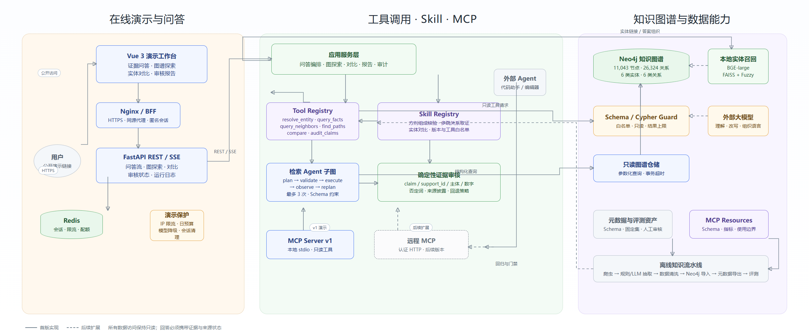

# 证据可追溯中医知识图谱工作台技术与架构设计

> 文档状态：V1 系列设计基线，已确认并进入实施
>
> 编制日期：2026-11-21
>
> 适用版本：V1.0 公开演示核心版、V1.1 完整增强版
>
> 需求基线：
> [需求规格说明书](需求规格说明书-2026-11-21.md)
>
> 范围与取舍：
> [V1 版本范围与技术取舍](V1版本范围与技术取舍-2026-11-21.md)

## 1. 设计目标

在不重写现有图谱问答内核的前提下，把系统演进为：

- Vue 3 公开演示工作台。
- 稳定 REST/SSE API。
- 强类型只读 Tool。
- V1.1 声明式领域 Skill。
- V1.1 本地 stdio MCP Server。
- 可部署到单机环境的演示产品。

设计原则：

1. 证据优先，模型只负责理解和表达。
2. Tool 只能返回领域对象，不向模型暴露原始 Cypher 行。
3. MCP 是适配层，不复制业务逻辑。
4. 先模块化单体，不拆微服务。
5. 新能力通过 `v2` 契约接入，旧 `v1` 在迁移期保持兼容。
6. 前端、Web API、MCP 共用同一应用服务。

### 1.1 版本交付边界

| 能力 | V1.0 | V1.1 |
| --- | --- | --- |
| 现有 GraphQAEngine、Cypher Guard、证据审核、`/api/v1` | 保留 | 保留 |
| 应用服务、EntityId、四个首批只读 Tool | 交付 | 扩展 |
| API V2 问答、实体、邻居、路径与 Tool 发现 | 交付 | 兼容扩展 |
| Vue 证据问答与图谱探索 | 交付 | 补齐对比与报告 |
| 首次公网部署与异常状态 | 交付 | 强化 |
| 对比、报告、Skill Registry、stdio MCP | 不阻塞 | 交付 |

V1.0 先形成可访问的核心产品，V1.1 再补齐技术差异化能力。版本之间不得复制业务实现。

## 2. 系统架构



该图展示 V1 系列目标态；V1.0 先交付 Vue、FastAPI、应用服务、Tool 和核心部署，Skill Registry 与 MCP 在 V1.1 接入。

架构分为三部分：

- 在线演示与问答：Vue、Nginx/BFF、FastAPI、Redis。
- 工具、Skill 与 MCP：应用服务、Tool Registry、Skill Registry、检索子图、证据审核和 MCP。
- 知识图谱与数据能力：Neo4j、Guard、BGE/FAISS、外部模型、元数据、评测和离线流水线。

## 3. 总体分层

```text
表现层
  Vue SPA
  FastAPI REST/SSE
  MCP stdio Adapter

应用层
  QA Application Service
  Graph Explorer Service
  Comparison Service
  Audit Service
  Report Service
  Tool Registry
  Skill Registry

领域与 Agent 层
  Retrieval Planning
  Controlled Query Plans
  Evidence Audit
  Contract Models

基础设施层
  Neo4j Repository
  Redis Session/Limit Store
  BGE + FAISS
  LLM Adapter
```

依赖方向只能从上向下。基础设施不得反向依赖 Web 或 MCP。

## 4. 前端架构

### 4.1 技术选型

```text
Vue 3
TypeScript
Vite
Vue Router
Pinia
TanStack Query for Vue
Element Plus
Cytoscape.js
ECharts
Vitest + Vue Test Utils
Playwright
```

选择 Vue 的原因：

- 对没有 React 经验的单人开发更易上手。
- Composition API 与 Python 开发者熟悉的分层逻辑接近。
- Vue 在国内项目中使用广泛。
- Cytoscape.js 等图谱库与框架无关，能力足够。

不使用 Nuxt/SSR：

- 系统是登录后或公开工作台型 SPA。
- 不需要搜索引擎收录和首屏 SSR。
- 减少 Node 服务端和部署复杂度。

### 4.2 目录结构

```text
frontend/
├── src/
│   ├── app/
│   │   ├── router/
│   │   ├── layouts/
│   │   └── providers/
│   ├── features/
│   │   ├── qa/
│   │   ├── explorer/
│   │   ├── comparison/
│   │   ├── audit/
│   │   └── developer/
│   ├── components/
│   ├── services/
│   ├── stores/
│   ├── types/
│   ├── styles/
│   └── main.ts
├── tests/
└── vite.config.ts
```

### 4.3 页面路由

| 路由 | 页面 |
| --- | --- |
| `/` | 项目首页和推荐场景 |
| `/qa` | 证据问答 |
| `/explorer` | 图谱探索 |
| `/compare` | V1.1 实体对比 |
| `/quality` | V1.1 独立质量与评测入口 |
| `/developer` | V1.0 API 与 Tool 接入；V1.1 增加 Skill、MCP |
| `/runs/:runId` | 单次运行和证据详情，可选 |

### 4.4 状态职责

- TanStack Query：服务端数据、缓存、重试和失效。
- Pinia：匿名会话、当前实体、筛选器、页面 UI 状态。
- URL Query：可分享的实体、筛选条件和对比目标。
- SSE：POST `/api/v2/qa/stream` 使用 `fetch` 流式解析，不使用浏览器 `EventSource`。

### 4.5 图谱可视化

使用 Cytoscape.js：

- 一跳邻居图最多显示 50 个节点。
- 关系方向和类型有明确图例。
- 节点点击不自动发起无限制递归，只触发下一次显式探索。
- 多跳路径固定高亮节点链和关系序列。
- 节点、边与右侧证据卡片双向联动。
- 不对用户渲染完整 11,043 节点图。

### 4.6 安全渲染

- 模型回答使用受限 Markdown 渲染器。
- 必须经过 HTML 白名单清理。
- 图表节点文本必须转义。
- API Key、数据库信息和完整异常堆栈不进入浏览器状态。

## 5. 后端架构

### 5.1 模块化单体

V1 系列保持一个 FastAPI 部署单元，但按职责分层：

```text
graph_qa/
├── application/
│   ├── qa_service.py
│   ├── explorer_service.py
│   ├── comparison_service.py
│   ├── audit_service.py
│   └── report_service.py
├── tools/
│   ├── contracts.py
│   ├── registry.py
│   ├── executor.py
│   └── catalog/
├── skills/
│   ├── contracts.py
│   ├── registry.py
│   ├── executor.py
│   └── manifests/
├── interfaces/
│   ├── api/
│   └── mcp/
└── infrastructure/
```

现有模块在迁移期间保留原路径，通过兼容导入逐步迁移。禁止一次性移动全部文件。

### 5.2 应用服务职责

应用服务负责：

- 校验页面级业务输入。
- 调用 Tool 或现有 GraphQAEngine。
- 组装页面需要的结构化响应。
- 发布稳定领域错误。

应用服务不负责：

- 解析 HTTP 请求。
- 管理 Vue 状态。
- 直接拼接 Cypher。
- 保存模型隐藏推理。

## 6. API V2 契约

### 6.1 兼容策略

- `/api/v1` 在迁移期保留。
- Vue、Tool 和 MCP 使用 `/api/v2`。
- Streamlit 达到能力对齐后再退役。
- V2 稳定后再单独安排 V1 弃用。

V1.0 只交付问答、实体、邻居、路径和 Tool 发现所需接口；对比、审核和报告接口可在 V1.1 启用，但路由设计应保持兼容。

### 6.2 接口

```text
POST /api/v2/qa
POST /api/v2/qa/stream
POST /api/v2/entities/search
GET  /api/v2/entities/{entity_id}
GET  /api/v2/entities/{entity_id}/neighbors
POST /api/v2/paths
POST /api/v2/comparisons
POST /api/v2/audits
POST /api/v2/reports
GET  /api/v2/tools
GET  /api/v2/skills
GET  /api/v2/schema/summary
```

### 6.3 公共响应包络

```text
ApiEnvelope<T>
- request_id: str
- run_id: str | null
- data: T | null
- evidence: list[EvidenceDto]
- warnings: list[WarningDto]
- error: ApiError | null
- meta: ResponseMeta
```

`ResponseMeta` 至少包含：

- `schema_version`
- `tool_version` 或 `skill_version`
- `duration_ms`
- `degraded`

### 6.4 SSE 事件

保留：

- `stage`
- `evidence`
- `facts`
- `aggregates`
- `paths`
- `audit`
- `answer_delta`
- `warning`
- `error`
- `done`

新增字段必须向后兼容，不改变已有事件语义。

## 7. 实体 ID 与领域 DTO

### 7.1 EntityId

不修改 Neo4j 数据。应用启动时从实体索引生成：

```text
entity_id = "eid_" + sha256(f"{label}\0{name}").hexdigest()[:32]
```

服务端保存 `entity_id -> (label, name)` 映射。

目的：

- URL 中不直接拼接中文名称。
- 同名不同标签不会冲突。
- MCP 和前端使用稳定标识。
- 标签和名称在返回 DTO 中仍可见。

该 ID 是基于当前实体内容派生的 ID，不是永久业务身份键。实体名称修改后 ID 会变化。V1.0 接受这一限制并通过“ID 不存在”稳定返回；未来若 Neo4j 引入稳定 `uid`，需要同时保留旧 ID 兼容映射和迁移策略。

### 7.2 核心 DTO

```text
EntityRef
- entity_id
- label
- name

EvidenceDto
- evidence_id
- subject
- subject_label
- relationship
- object
- object_label
- source

PathEvidenceDto
- path_id
- root
- steps
- target
- sources

VerificationDto
- status
- checked_items
- matched_items
- missing_sources
- fallback_used
```

## 8. Tool Registry

### 8.1 Tool 契约

```text
ToolDefinition
- tool_id
- version
- description
- input_schema
- output_schema
- timeout_seconds
- max_rows
- scopes
- audit_policy
```

Tool 执行结果：

```text
ToolResult<T>
- data
- evidence
- warnings
- run_id
- degraded
```

### 8.2 V1 Tool

| Tool | 用途 | 版本 |
| --- | --- | --- |
| `resolve_entity` | 名称/别名/模糊召回并返回 EntityRef | V1.0 |
| `query_entity_facts` | 查询白名单属性 | V1.0 |
| `query_neighbors` | 查询一跳邻居和关系 | V1.0 |
| `find_evidence_paths` | 查找 2～3 步受控路径 | V1.0 |
| `compare_entities` | 对比属性和关系 | V1.1 |
| `audit_claims` | 校验 claims 与证据 | V1.1 |
| `get_source` | 获取文献和来源关联 | V1.1 |

约束：

- 只读。
- 参数化。
- 不接受任意 Cypher。
- 每个 Tool 独立限时。
- 结果必须有结构化错误。

## 9. Skill Registry（V1.1）

### 9.1 Skill 定义

Skill 是声明式工作流，不是任意代码或单一 Prompt。

```text
SkillDefinition
- skill_id
- version
- description
- input_schema
- output_schema
- allowed_tools
- max_tool_calls
- timeout_seconds
- evidence_policy
- fallback_policy
- evaluation_cases
```

### 9.2 V1.1 Skill

1. `formula_composition_review`
   - 识别方剂。
   - 查询组成。
   - 查询相关属性和功效。
   - 核验用户陈述。

2. `multi_hop_evidence_trace`
   - 识别起点。
   - 受控查找路径。
   - 返回逐跳证据并审核。

3. `entity_comparison`
   - 选择两个实体。
   - 查询白名单属性和关系。
   - 计算共同项和差异项。

### 9.3 Skill 执行策略

- V1.1 由明确用户入口或 MCP 调用选择 Skill。
- 不让模型自由新增工具。
- Tool 调用顺序由 Skill 配置和确定性执行器控制。
- 超出最大 Tool 调用次数时安全终止。

## 10. Agent 与 Tool 的边界

现有检索 Agent 子图继续负责：

- 查询计划选择。
- 校验、执行和观察决策。
- 最多三次循环。

新增 Tool 层位于应用服务与领域能力之间：

- Web 页面和 MCP 先调用 Tool。
- Tool 可调用现有 GraphQAEngine 或应用服务。
- 检索 Agent 不直接暴露给外部客户端。
- 证据审核保持确定性，不交给模型评分。

不新增“自由选择任意工具”的自治 Agent。

## 11. MCP Server（V1.1）

### 11.1 V1.1 形态

```text
本地 MCP Client
  -> stdio MCP Server
  -> 应用服务/Tool API
  -> Neo4j / Redis / LLM
```

stdio 进程作为薄客户端，可连接本地或远程 FastAPI。它不打包 Neo4j 数据，不直接加载 BGE。

### 11.2 Resources

- `tcmkg://schema`
- `tcmkg://metadata`
- `tcmkg://evaluation/latest`
- `tcmkg://tools`
- `tcmkg://skills`
- `tcmkg://guide`

### 11.3 Tools

与 V1 Tool Registry 保持一致。MCP 不增加第二套工具实现。

### 11.4 远程 MCP

后续版本再增加：

- HTTP 传输。
- OAuth/API Key。
- 按客户端限流。
- 审计和配额。
- 多用户并发。

V1.1 不开放公网无认证 MCP。

## 12. 演示安全与匿名会话

公开演示不使用静态 API Key 直接暴露给浏览器。

建议：

```text
Vue
  -> 同源 Nginx
  -> FastAPI BFF
  -> HttpOnly 匿名演示 Cookie
  -> Redis 配额
```

匿名 Cookie 包含：

- 随机会话 ID。
- 过期时间。
- 无个人信息。

服务端配额：

- 每 IP 每分钟请求数。
- 每 Cookie 轮数。
- 全站每日模型调用上限。
- 最大并发。

模型不可用时：

- 显示稳定降级状态。
- 明确区分实时、缓存和确定性降级模式。
- 固定演示问题继续走已缓存或确定性路径。
- 不把底层异常和凭据暴露给用户。

## 13. 数据与基础设施

- Neo4j：现有图谱和只读仓储。
- Redis：匿名会话、限流、并发租约。
- BGE + FAISS：本地实体召回。
- 外部大模型：改写、意图、抽取和回答。
- 元数据：Schema、关系和属性白名单。
- 评测资产：黄金集、产品集、多轮集和人工审核包。

不修改图数据库结构。

来源增强涉及图结构或导入数据变化，必须先确认来源真实性和再分发授权，再单独设计迁移。V1.0 不通过扩展 DTO 伪造章节、页码或原文。

## 14. 部署架构

```text
Internet
  -> HTTPS / Nginx
      -> Vue static dist
      -> /api -> FastAPI
  -> Redis
  -> Neo4j
  -> external LLM
```

V1 系列推荐单机 Docker Compose：

- Nginx。
- FastAPI。
- Redis。
- Neo4j 可使用托管实例或独立容器。
- BGE 和 FAISS 运行在 API 单 worker 或独立推理服务。

公网只开放 80/443，API、Redis、Neo4j 不直接映射到公网。

首次公网部署在 V1.0 问答页和图谱探索完成、核心异常状态可用后执行，不等待 Skill 和 MCP。V1.0 先验证域名、HTTPS、内存、模型费用和陌生用户操作，V1.1 再执行完整增强能力回归。

## 15. 可观测性

第一阶段至少记录：

- request_id、run_id、session 匿名 ID。
- 路由、状态码、耗时。
- 查询类型和 Tool ID。
- 模型调用成功/失败分类。
- Neo4j 查询耗时和结果数量。
- 证据数量和审核状态。

不记录：

- API Key。
- 数据库密码。
- 完整提示词。
- 模型隐藏推理。
- 完整 Cypher 返回行。

## 16. 测试架构

- Python：pytest。
- Vue：Vitest + Vue Test Utils。
- OpenAPI 契约测试。
- V1.0 Tool 契约测试。
- V1.1 Skill 契约与 MCP 协议测试。
- 浏览器 E2E：Playwright。
- 真实 Neo4j/Redis 集成测试单独启用。

## 17. 技术风险与取舍

| 风险 | 取舍 |
| --- | --- |
| Vue 学习成本 | 比 React 低，适合当前单人快速上线目标 |
| 图谱可视化过重 | 只显示邻域和路径，不渲染全图 |
| 首发范围膨胀 | V1.0 只阻塞问答、探索、证据和部署，其余进入 V1.1 |
| Tool 数量膨胀 | V1 系列限制为 7 个以内，V1.0 只交付 4 个 |
| Skill 路由复杂 | V1.1 由用户或 MCP 明确选择 Skill |
| MCP 安全复杂 | 先做 stdio，远程延后 |
| 外部模型不稳定 | 固定问题、缓存和明确标识的降级模式 |
| 来源数据不足 | 只展示真实来源或缺失状态，来源增强独立治理 |
| EntityId 变化 | 明确为内容派生 ID，未来引入稳定业务 ID 时做兼容 |
| 数据授权不明 | 未确认再分发授权的内容不进入公网演示 |
| 前后端契约漂移 | 从 OpenAPI 生成 TypeScript 类型 |
| API 迁移风险 | v1/v2 并行，Streamlit 最后退役 |
| 单机容量有限 | V1 系列接受单 worker，先量化 P95 和并发 |

## 18. 关键实现约束

- 不允许前端直接调用 Neo4j。
- 不允许 MCP 直接调用 Neo4j。
- 不允许 Tool 接受任意 Cypher。
- 不允许 Skill 自由创建 Tool。
- 不允许回答模型把无来源内容写成确定事实。
- 不允许为了演示效果绕过现有 Guard 和证据审核。
